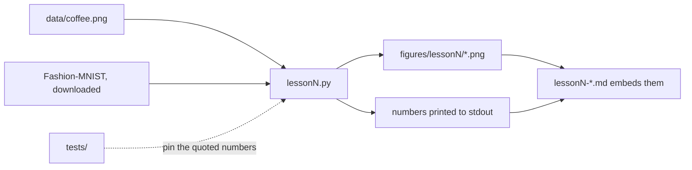
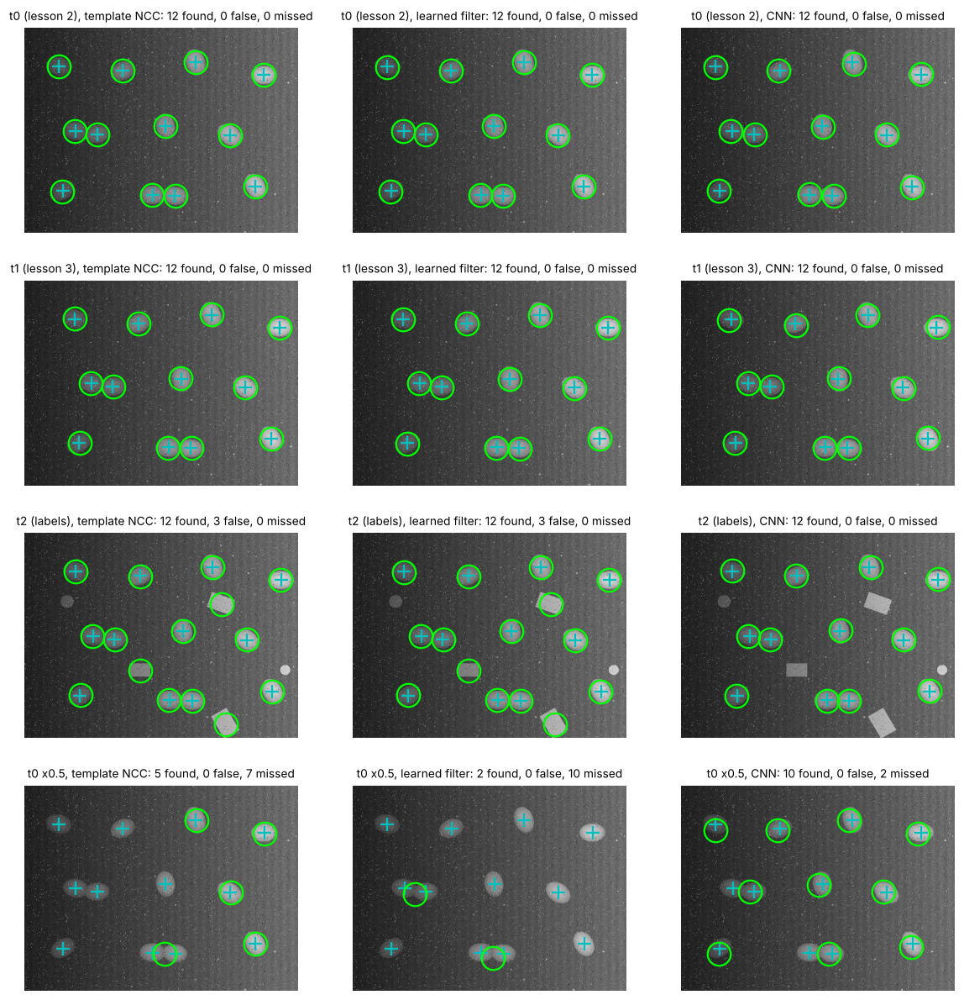
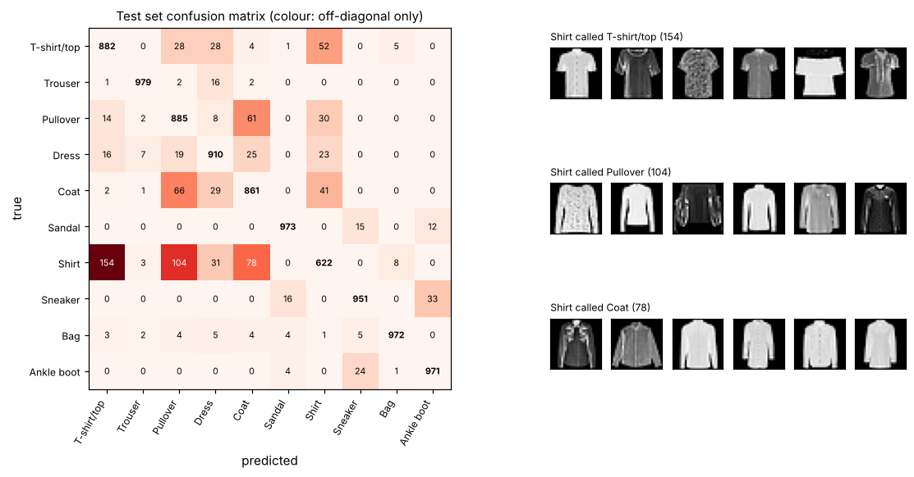

# Computer Vision Fundamentals

A six-lesson, hands-on course: NumPy and OpenCV first, PyTorch from lesson 4. Each lesson is a Markdown chapter of 1 500–3 000 words with one worked example, 3–5 exercises (answers collapsed), Mermaid diagrams where a picture helps and a "What to read next" list. Every piece of code a lesson shows is in a runnable `lessonN.py` that prints the numbers the text quotes and writes the figures the text embeds, so nothing in the prose is unverifiable.

The examples lean towards agriculture (eggs on a belt, birds in a shed, leaves in a field) because that is where the author's other repositories live, but nothing depends on it.

## Lessons

| # | Lesson | One line |
|---|---|---|
| 1 | [Images as arrays, colour spaces, histograms](lesson1-images-as-arrays.md) | Shape, dtype and the uint8 trap; gray, HSV and Lab; reading a histogram; a hue threshold that separates a red saucer from a brown table where RGB cannot. |
| 2 | [Filtering, edges, morphology](lesson2-filtering-edges-morphology.md) | Kernels that sum to 1 or 0; box, Gaussian and median scored against a noise-free frame; Sobel and Canny; erosion, dilation, opening, closing on a toy shape; cleaning the lesson-1 mask; counting 12 eggs on a synthetic conveyor belt with a top-hat, Otsu and the distance transform. |
| 3 | [Features and matching, homography](lesson3-features-matching-homography.md) | The structure tensor and why corners are findable; ORB and SIFT scored for repeatability against a known warp; nearest-neighbour matching, the ratio test and cross-check; four-point DLT, least squares and RANSAC compared by transfer error; an oblique camera over the belt, rectified from four markers, and the belt's travel read in millimetres from matched features. |
| 4 | [Classical detection to CNNs](lesson4-classical-detection-to-cnns.md) | A mean-egg template with normalised cross-correlation and non-maximum suppression; a 3 × 3 kernel learned by gradient descent until it is Sobel, fast on noise and slow on a photograph (and why); one learned 64 × 64 filter and what it can never separate; a 6 129-parameter CNN whose first-layer filters sort into blurs and derivatives; the same network run fully convolutionally over a frame, scored against labels, blobs and a change of scale. |
| 5 | [Training a small classifier properly](lesson5-training-a-small-classifier.md) | Three sets with three jobs, cut once and stratified; early stopping by the validation set and why the loss overfits before the accuracy; augmentation as a claim about the test set, measured on Fashion-MNIST (a 2-pixel shift removes the overfitting, not the errors, and costs 3 points at a fixed budget); seeds and the width of a number; the augment-then-split leak (4.6 points of flattery); a 20 490-parameter CNN trained on 54 000 real images and scored once on the test set, 90.1 %, with the confusion matrix showing that 634 of its 994 errors are between four upper-body garments. |
| 6 | Object detection with a pre-trained model | *(not yet written)* fine-tuning on 50 images, mAP, edge deployment. |

## Running the lessons

```bash
python -m venv .venv && source .venv/bin/activate
pip install -r requirements.txt
python lesson1.py                 # prints the lesson's numbers, writes figures/lesson1/
python lesson1.py path/to/your.jpg
python lesson2.py                 # imports lesson1.py; run from the repo root
python lesson3.py                 # imports lesson1.py and lesson2.py
python lesson4.py                 # trains on the CPU, about 30 s
python lesson5.py                 # downloads Fashion-MNIST (30 MB) once, then about 7 min on 4 cores
make check                        # ruff + pytest + every lesson script
```

Python 3.11 or newer. OpenCV is the headless build, so nothing opens a window; look at the PNGs in `figures/`. Lessons 4 and 5 need PyTorch; `requirements.txt` pulls the default build, and on Linux the CPU-only build (`pip install torch --index-url https://download.pytorch.org/whl/cpu`) is a much smaller download and all the course uses.



## What the outputs look like

`python lesson1.py` prints the array shape and size, the uint8 wrap-around demo, three HSV samples, a patch table of red-channel versus hue statistics, and the fraction of the image each mask selects, and writes five figures. The last one is the worked example:


`python lesson2.py` prints the region counts as the lesson-1 mask is opened, closed and reduced to one component (715 regions to 1), a filter table scored against the noise-free belt frame, a Sobel profile across the saucer rim, the share of edge pixels Canny marks at two threshold pairs and three blur widths, a pixel/region/hole table for erosion, dilation, opening and closing, and the egg count at each stage of the worked example (global threshold: 7 blobs including the lit half of the belt; top-hat: 10 blobs; distance-transform peaks: 12, the true number). The last figure:


`python lesson3.py` prints the known homography and where it sends the frame corners, the structure-tensor eigenvalues at a flat, an edge and a corner pixel, ORB and SIFT keypoint counts and repeatability (86.8 % and 45.5 % within 3 px, with a no-dimming control), a matching table (nearest neighbour, ratio test, cross-check: ORB goes from 73.0 % to 95.7 % precision), the four-point, least-squares and RANSAC homography errors at the frame corners (ORB RANSAC max 1.30 px, SIFT 0.22 px), and the worked example: lesson 2's counter finds 9 and 10 eggs on the oblique frames and 12 and 12 after rectification, and the belt travel read from 31 inlier matches is 36.79 mm against a true 37. The last figure:


`python lesson4.py` prints the patch-set composition, the template's threshold and accuracy (0.582, 87.2 %), the curvature ratio of the kernel-learning problem on the coffee image and on white noise (741 against 1) with the learned 3 × 3 kernel after 300 and 20 steps, the learned filter's accuracy (89.3 %) and its cosine with the template (0.89), the CNN's parameter count (6 129), its 16-epoch validation curve (86.6 % to 98.9 %), the sums of its first-layer filters, a validation table by kind of patch (labels: template 44 %, learned filter 19 %, CNN 95 %), the fully convolutional check (one logit map entry equals the patch's own logit to four decimals), the detection table on three frames (12 of 12 everywhere; 3 false alarms on the three labels for the template and the filter, 0 for the CNN) and the scale table (at half size 5, 2 and 10 of 12; 12 of 12 after resizing back). The last figure:



`python lesson5.py` prints the download and hash check, the stratified split (54 000 / 6 000 / 10 000, 600 per class in validation against 46 to 77 for a random sample), the majority and linear baselines (10.0 % and 79.5 % on 1 000 images), the seed-0 learning curves at 1 000 and 10 000 images for no augmentation, shift and shift + flip (best epoch, lowest validation loss and the training loss at the end), the dataset's own positional spread and shoe direction (99.7 % of sneakers and 100 % of ankle boots face the same way), the three-seed table (1 000 images: 83.5 % without augmentation against 83.1 % with the shift; 10 000 images at 8 epochs: 85.7 % against 82.7 %), the leak demonstration (88.0 % on a validation half that shares sources with the training half, 83.4 % on the clean one), and the worked example: validation accuracy per epoch on the full training set, then the test set opened once (90.1 %, macro F1 0.899), the per-class precision, recall and F1 table and the five most confused pairs (Shirt called T-shirt/top 154 times). The last figure:



## Repository layout

| Path | What it is |
|---|---|
| `lessonN-<slug>.md` | the lesson text; every number it quotes is printed by the script |
| `lessonN.py` | the runnable code for that lesson, importable by later lessons and by the tests |
| `tests/test_lessonN.py` | pins the quoted numbers so a library change breaks a test before it misleads a reader |
| `figures/lessonN/` | the PNGs the lesson embeds, regenerated by the script and committed |
| `data/` | images with their source and licence in `data/README.md`; the synthetic belt frames are rewritten by the lesson scripts; `data/fashion-mnist/` is downloaded by lesson 5 and not committed |
| `WALKTHROUGH.md` | notes for the author on each lesson's design and likely questions |

## Data

`data/coffee.png` is the CC0 "coffee" sample image distributed with scikit-image, copied into the repo so the lessons need no download. `data/belt_synthetic.png` is **not a photograph**: lesson 2 draws it from a fixed seed so the egg count is known, and rewrites it on every run. `data/belt_oblique_t0.png` and `_t1.png` are the same belt seen through a fictional oblique camera in two frames 37 mm of travel apart, written by lesson 3. Provenance and licences are in [`data/README.md`](data/README.md). Lesson 5 downloads **Fashion-MNIST** (Zalando Research, MIT licence; 70 000 real 28 × 28 photographs of clothing in ten classes) into `data/fashion-mnist/`, which is gitignored, and checks the four files against SHA-256 hashes recorded in `lesson5.py` before reading them. Its licence and provenance are in `data/README.md` too.

## Limitations

- One photograph so far; lesson 1's thresholds are read off *its* histogram and are not claimed to transfer. The lesson says so and shows how to re-derive them.
- Lesson 2's egg counter is scored on a synthetic frame. It counts 12 of 12 there; the lesson lists what would break on real footage (uneven egg sizes, three eggs in a row, hard shadows, belt seams) and does not claim a result on real eggs.
- Lesson 3's feature numbers come from one photograph warped by a chosen homography and from the synthetic belt. The SIFT repeatability of 45.5 % is what a 3-pixel test gives on this image at a 0.85 shrink with dimming; it is not a general ranking of SIFT against ORB. On the belt ORB finds only 31 inlier matches, because the scene is smooth; the lesson says so rather than tuning the scene until the number looks better. The oblique camera and its four markers are placed by the script, not measured.
- Lesson 4's detectors are trained and scored on patches and frames rendered by the same generator, so its 98.9 % says the network learned the generator, not eggs. The labels and blobs are invented negatives. One seed, no augmentation and 4 000 patches make the validation curve noisy and the first-layer filters rough; the tests pin ranges, not digits, and a different PyTorch version may move the last-epoch number.
- Lesson 5's numbers are one validation split and, for the full-data run, one seed; the subsets' seed spreads (0.7 to 2.5 points) say how far a repeat may move them, and the test accuracy of 90.1 % is far below what Fashion-MNIST supports, because the network and the budget were kept small enough to run in minutes on a CPU. Augmentation did not help at these budgets on this centred data set, and the lesson says so and why, rather than tuning until it did.
- The sandbox the course is written in cannot reach most image hosts, so lessons use images bundled with Python packages, generated by code in the repo, or (lesson 5) downloaded from a GitHub-hosted data set with a clear licence and a hash check; CIFAR-10 was not reachable.
- No notebooks yet; the `.py` scripts are the reference. Notebooks, if added, will have outputs cleared and will not be the only copy of any code.

## Next steps

- Lesson 5's full-data run could be repeated with three seeds and with the shift augmentation at 30 epochs (about 15 minutes) to see whether the regulariser pays once the un-augmented network has time to overfit on 54 000 images; `SEEDS`, `EPOCHS_BY_SIZE` and `FINAL_EPOCHS` in `lesson5.py` are the knobs.
- Lesson 5's protocol runs unchanged on any small labelled image set; a real agricultural one (leaf diseases, egg grades) with a clear licence would make it the course's first real-data agricultural result, with `data/README.md` holding the licence.
- Lesson 4's `EggNet` is trained on one scale and run on a pyramid by hand; a version with a third pool and a scale-augmented patch set would show how far augmentation can replace the pyramid.
- Lesson 3's belt-travel pipeline is the natural front end for the counting-line tracker that lesson 2's exercise 4 and lesson 3's exercise 5 describe; a `track_eggs()` over a sequence of frames from `make_belt(shift=...)` would make it code.
- Lesson 6's detector is meant to replace lesson 2's egg counter on real images, which is where the counter's limitations become measurable rather than listed.
- A real belt or shed photograph with a hand-counted answer would let lesson 2's pipeline be scored on something that is not synthetic; `data/README.md` is where its licence would go.
- Notebooks remain optional. If added, each will be generated from its `lessonN.py` so the script stays the single source of the code.

## Licence

MIT, see [LICENSE](LICENSE). The sample image has its own (CC0) licence, noted in `data/README.md`.
