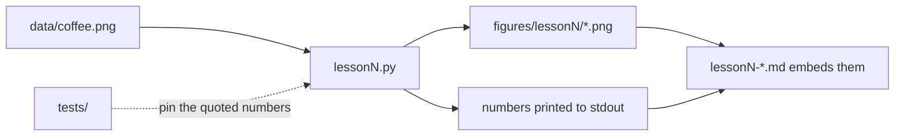

# Computer Vision Fundamentals

A six-lesson, hands-on course: NumPy and OpenCV first, PyTorch from lesson 5. Each lesson is a Markdown chapter of 1 500–3 000 words with one worked example, 3–5 exercises (answers collapsed), Mermaid diagrams where a picture helps and a "What to read next" list. Every piece of code a lesson shows is in a runnable `lessonN.py` that prints the numbers the text quotes and writes the figures the text embeds, so nothing in the prose is unverifiable.

The examples lean towards agriculture (eggs on a belt, birds in a shed, leaves in a field) because that is where the author's other repositories live, but nothing depends on it.

## Lessons

| # | Lesson | One line |
|---|---|---|
| 1 | [Images as arrays, colour spaces, histograms](lesson1-images-as-arrays.md) | Shape, dtype and the uint8 trap; gray, HSV and Lab; reading a histogram; a hue threshold that separates a red saucer from a brown table where RGB cannot. |
| 2 | Filtering, edges, morphology | *(not yet written)* with a conveyor-belt egg-counting toy example. |
| 3 | Features and matching, homography | *(not yet written)* |
| 4 | Classical detection to CNNs | *(not yet written)* what a convolution learns. |
| 5 | Training a small classifier properly | *(not yet written)* splits, augmentation, metrics, confusion matrix. |
| 6 | Object detection with a pre-trained model | *(not yet written)* fine-tuning on 50 images, mAP, edge deployment. |

## Running the lessons

```bash
python -m venv .venv && source .venv/bin/activate
pip install -r requirements.txt
python lesson1.py                 # prints the lesson's numbers, writes figures/lesson1/
python lesson1.py path/to/your.jpg
make check                        # ruff + pytest + every lesson script
```

Python 3.11 or newer. OpenCV is the headless build, so nothing opens a window; look at the PNGs in `figures/`.



## What the outputs look like

`python lesson1.py` prints the array shape and size, the uint8 wrap-around demo, three HSV samples, a patch table of red-channel versus hue statistics, and the fraction of the image each mask selects, and writes five figures. The last one is the worked example:


## Data

`data/coffee.png` is the CC0 "coffee" sample image distributed with scikit-image, copied into the repo so the lessons need no download. Provenance and licence are in [`data/README.md`](data/README.md). Later lessons that need datasets say in the same file where they come from and under which licence.

## Limitations

- One image so far; lesson 1's thresholds are read off *its* histogram and are not claimed to transfer. The lesson says so and shows how to re-derive them.
- The sandbox the course is written in cannot reach most image hosts, so lessons use images bundled with Python packages or generated by code in the repo, labelled as such.
- No notebooks yet; the `.py` scripts are the reference. Notebooks, if added, will have outputs cleared and will not be the only copy of any code.

## Licence

MIT, see [LICENSE](LICENSE). The sample image has its own (CC0) licence, noted in `data/README.md`.
