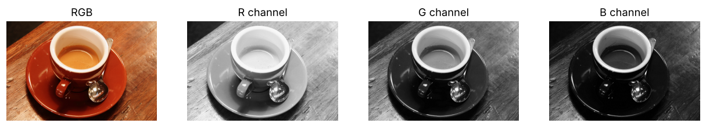
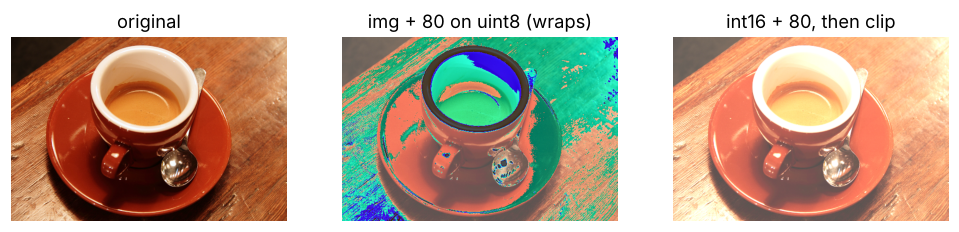
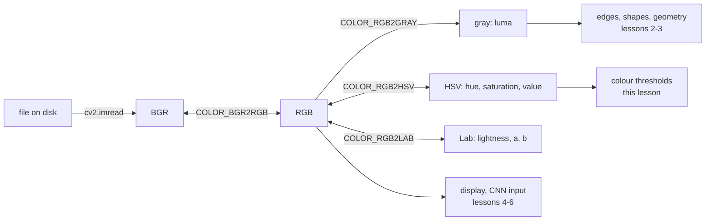
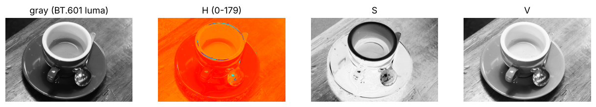
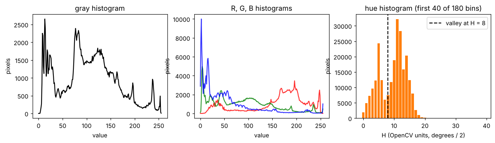
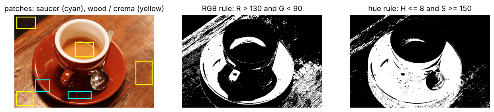

# Lesson 1 - Images as arrays, colour spaces, histograms

*Everything a camera gives you is a grid of numbers. Learn the grid before learning the tricks.*

This course is for people who can write Python and want to make a computer see something useful: count eggs on a belt, spot a sick bird in a shed, read a gauge. The first four lessons use NumPy and OpenCV only; lessons 5 and 6 add PyTorch. Each lesson has one runnable script, here `lesson1.py`, which prints every number quoted below and writes every figure to `figures/lesson1/`. Run it before reading, then on a photo of your own.

The photo used throughout is `data/coffee.png`, a CC0 sample image that ships with scikit-image (see `data/README.md`). It was chosen because it is warm and low-contrast: a red saucer on a brown table, lit from one side, harder and more realistic than a textbook image on a white background.

## 1. An image is an array

Load the image and look at what you have:

```python
import cv2, numpy as np

bgr = cv2.imread("data/coffee.png")  # OpenCV decodes to B, G, R order
rgb = cv2.cvtColor(bgr, cv2.COLOR_BGR2RGB)  # convert once, at the boundary
print(rgb.shape, rgb.dtype, rgb.nbytes)  # (400, 600, 3) uint8 720000
```

Three facts to make permanent:

- **Shape is (rows, columns, channels)**, so (height, width, 3). The first index is the row, which is the *y* coordinate, counted from the top. `rgb[150, 300]` is the pixel 150 rows down and 300 columns across, not the other way round. On this image it is `[232 151 62]`, a pixel in the crema.
- **dtype is `uint8`**: each channel is an integer from 0 to 255. Not 0.0 to 1.0, not signed, not 16-bit. Every arithmetic surprise in this lesson follows from this.
- **Size is rows × columns × channels bytes.** 400 × 600 × 3 = 720 000 bytes for this small photo. A 1920 × 1080 frame is 6.2 MB; at 30 frames per second a camera produces 187 MB of raw pixels every second. That is why cameras compress, why edge devices resize first, and why "just send the images to the cloud" is rarely a plan.

Because an image is an ordinary array, slicing *is* image editing. No library call is needed:

| Expression | Result |
|---|---|
| `rgb[100:200, 50:150]` | a crop, shape (100, 100, 3) |
| `rgb[::2, ::2]` | every second row and column: half size, shape (200, 300, 3) |
| `rgb[::-1]` | flipped top-to-bottom |
| `rgb[:, ::-1]` | mirrored left-to-right |
| `rgb[..., 0]` | the red channel alone, shape (400, 600) |
| `rgb[..., ::-1]` | channels reversed: RGB becomes BGR |

The last row is the most common bug in beginner code. OpenCV reads and writes files in BGR order; matplotlib, PIL, PyTorch and every colour picker assume RGB. Mixed up, a red saucer displays as blue and a trained network sees colours it never saw in training. Convert once when you load and once when you save with `cv2.imwrite`.



Notice that the red channel is bright nearly everywhere, because this photo is warm: the mean values per channel are R 158.6, G 85.8, B 51.5. The blue channel is dark except on the spoon and the rim of the cup, which are the only neutral surfaces.

## 2. The uint8 trap

Try to brighten the image the obvious way:

```python
brighter = rgb + 80  # uint8 + int stays uint8
```

NumPy keeps the dtype, and `uint8` arithmetic wraps around: 200 + 100 = 300, which does not fit in a byte, so it becomes 300 − 256 = 44. Every channel value above 175 wraps to a dark one. On this warm image red wraps first, so the middle panel below shows the cup's highlights turning green and blue.



Two correct options:

```python
out = np.clip(rgb.astype(np.int16) + 80, 0, 255).astype(np.uint8)  # widen, add, clip
out = cv2.add(rgb, 80)  # OpenCV saturates
```

OpenCV's arithmetic functions (`cv2.add`, `cv2.subtract`, `cv2.addWeighted`) saturate instead of wrapping: 200 + 100 gives 255. NumPy's do not. The safest habit is to convert to `float32` before doing any maths on pixels and convert back with `np.clip(...).astype(np.uint8)` once at the end. Differences bite the same way: `a - b` on `uint8` is wrong whenever `b > a`, which is why `cv2.absdiff` exists.

## 3. Colour spaces

RGB is how sensors capture and screens display, but it is a poor space for most decisions, because all three channels change together when the light changes. A shadow falling on the saucer lowers R, G *and* B. Other colour spaces separate "what colour" from "how bright".



### Grayscale is a weighted sum, not a mean

```python
gray = cv2.cvtColor(rgb, cv2.COLOR_RGB2GRAY)
# equivalent, to within rounding:
gray = np.round(0.299 * R + 0.587 * G + 0.114 * B).astype(np.uint8)
```

The weights come from the ITU-R BT.601 standard and model how bright each primary looks to a human eye: green contributes most, blue least. `lesson1.py` checks that the manual formula and OpenCV differ by at most 1. Taking the plain mean of the channels is a common shortcut and a wrong one: pure green (0, 255, 0) has a mean of 85 and a luma of 150, pure blue (0, 0, 255) also has a mean of 85 but a luma of 29. With the mean, green grass and a blue tarpaulin become the same shade of grey; with luma they are five times apart. Use grayscale for anything about shape (edges, corners, contours), which is lessons 2 and 3.

### HSV separates colour from brightness

HSV describes a pixel by **hue** (which colour, as an angle round the colour wheel: red at 0°, green at 120°, blue at 240°), **saturation** (how far from grey, 0 for white or grey, high for a pure colour) and **value** (how bright). OpenCV stores these in `uint8` too, which forces one trap: hue runs 0 to 360 degrees but a byte stops at 255, so **OpenCV halves it and stores H from 0 to 179**. Red is near 0 *and* near 179, so a "red" threshold has to test both ends (exercise 3). S and V use the full 0 to 255.



The H plane is nearly uniform, because the whole scene is red-orange-brown, with the saucer a slightly different hue from the wood. The S plane is dark only on the spoon and the inside rim of the cup: those are the neutral objects. The V plane is a brightness map, close to the grayscale image. Three example pixels, as (H, S, V):

| Pixel | Where | H | S | V |
|---|---|---|---|---|
| (150, 300) | crema | 16 | 187 | 232 |
| (300, 120) | saucer | 5 | 238 | 161 |
| (50, 50) | wood, in shadow | 14 | 146 | 35 |

The crema and the shadowed wood are far apart in RGB ([232 151 62] versus [35 24 15]) but their hues are 16 and 14: the same colour, differently lit.

One caution the cup teaches: a white object is not white in a photo. The lower body of this white cup reflects the red saucer: pixel (200, 230) is [103 16 7], as red as the saucer, with S = 238. Only the inner rim stays near grey (S = 96 at (60, 300)). Colour is a property of the light reaching the sensor, not of the object, and any rule you write on colour inherits the lighting it was tuned under.

### Lab, in one paragraph

CIE Lab puts lightness on one axis (L) and colour on two (a: green to red, b: blue to yellow), scaled so that the Euclidean distance between two Lab points roughly matches how different the colours look to a person. Use it for "how far is this colour from that one" and for colour-balance corrections (`COLOR_RGB2LAB`). For thresholds, HSV is simpler to reason about.

## 4. Histograms

A histogram counts how many pixels take each value. For `uint8` data it is one line:

```python
hist = np.bincount(gray.ravel(), minlength=256)  # shape (256,), sums to 240 000
```

`cv2.calcHist` does the same with more arguments. A histogram throws away *where* pixels are and keeps *how many*: the right summary for exposure, contrast and thresholds, the wrong one for shape.



How to read the three panels:

- **Gray histogram.** Two humps: a dark one near 10 to 20 (the shadows, the wood at the edges) and a broad one from 70 to 200 (saucer, lit wood, cup). 24.5 % of the pixels are below 64. A histogram piled up at the far left means under-exposure; piled up at 255 means clipping, and the detail in the highlights is gone for good. Checking the histogram of a camera stream once a minute is the cheapest "is the lens dirty / is the lamp off" monitor you can build.
- **R, G, B histograms.** Red sits far to the right of the others: a colour cast. A camera's auto white balance works by shifting these back together.
- **Hue histogram.** Only the first 40 of the 180 bins are shown, because everything else is empty: the scene is all warm colours. There are two peaks, one at H = 5 and one at H = 11 to 12, with a valley at H = 8. Two peaks mean two populations of pixels, and the valley between them is a threshold that has to come from *this* image's histogram, not from a textbook. The worked example uses exactly this.

A histogram also tells you how to fix contrast. A **percentile stretch** maps the 1st percentile to 0 and the 99th to 255, clipping the extremes:

```python
lo, hi = np.percentile(gray, [1, 99])
stretched = np.clip((gray - lo) * 255.0 / (hi - lo), 0, 255).astype(np.uint8)
```

It spreads the histogram to the full width and sacrifices the 2 % of pixels already near the ends. Histogram equalisation (`cv2.equalizeHist`) flattens the histogram entirely; good for seeing detail, bad before anything that measures brightness, because it changes every image by a different amount. Exercise 5 looks at both.

## 5. Worked example: separate the saucer from the table

**Task.** Make a mask, a boolean array the same height and width as the image, that is `True` on the saucer and `False` on the wooden table. A mask like this is the first step of nearly every classical vision pipeline: count its pixels for an area, trace its outline for a shape, track it between frames for motion.

**Step 1: see why RGB does not work.** Both objects are reddish brown. `lesson1.py` samples six rectangles, drawn on the left panel of the figure below, and reports the red channel and the hue inside each:

| Patch | R mean | R sd | H mean | H sd |
|---|---|---|---|---|
| saucer (left) | 119.3 | 62.7 | 6.3 | 14.6 |
| saucer (bottom) | 46.8 | 16.8 | 3.9 | 17.6 |
| wood (top left) | 37.5 | 22.0 | 12.8 | 1.8 |
| wood (bottom left) | 214.7 | 22.2 | 13.8 | 2.3 |
| wood (right) | 163.0 | 15.0 | 10.3 | 1.1 |
| crema | 224.5 | 17.2 | 14.9 | 1.5 |

Read the R column first: the saucer spans 47 to 119 and the wood spans 37 to 215. There is no red value that separates them, and no green or blue value either, because both are "red minus some green minus more blue" scaled by the lighting. The best RGB rule I could find by hand, `R > 130 and G < 90`, gives the middle panel: it loses the shaded bottom of the saucer and picks up the whole lit area of the table.

Now the H column: every saucer patch is at 4 to 6, every wood patch at 10 to 14, and the spread within a wood patch is about 2. (The saucer's standard deviation of 15 to 18 is an artefact: a few dozen pixels per patch have hue 178 or 179, the other end of red, and the arithmetic treats them as 170 units away. Ignore those and the spread is 1 to 2. Exercise 3 fixes this properly.)



**Step 2: read the threshold off the histogram.** The hue histogram in section 4 has its valley at H = 8. `hue_valley()` finds it by smoothing the counts over three bins and taking the minimum between bins 3 and 12; the smoothing stops a single sparse bin from winning.

**Step 3: write the rule.**

```python
hsv = cv2.cvtColor(rgb, cv2.COLOR_RGB2HSV)
mask = (hsv[..., 0] <= 8) & (hsv[..., 1] >= 150)
```

The saturation term matters. Hue is undefined for grey pixels: when R, G and B are nearly equal, sensor noise decides the hue, often landing near 0. Requiring S ≥ 150 says "only clearly coloured pixels get to vote on colour", and removes the spoon, the rim and the darkest shadows.

**Step 4: check it.** The right panel is the result. Inside the saucer patches the mask covers 91 % and 99 % of pixels; inside the three wood patches it covers 2.0 %, 0.1 % and 4.2 %; inside the crema, 0 %. Overall it marks 35.5 % of the image.

Two things are visibly wrong, and both are instructive. The lower half of the cup is in the mask: that is the white cup reflecting the red saucer, tinted enough to have the saucer's hue. No colour rule can tell "red object" from "white object lit by red light", because the pixels are the same. The streaks on the left are wood grain in shadow, where the hue is noisy. Those are small and disconnected, and lesson 2's morphology removes them in two lines. Resist a tighter threshold: every threshold tightened to remove noise also removes some of the saucer.

**What this generalises to.** Replace "saucer" with "egg", "bird" or "warning light" and the method is the same: pick the channel in which the two populations separate, put the threshold in the valley of *its* histogram, add a saturation or brightness guard, and inspect the mask on patches you labelled by eye. If no single channel separates them, you need a learned classifier, which is where lesson 5 begins.

## Exercises

1. Without running code, write the shape of `rgb[50:250, ::3]`, `rgb[::-1, :, 0]` and `rgb[100, :, :]` for the (400, 600, 3) image. Which of the three is still an image you could display?
2. With `a = np.uint8(200)` and `b = np.uint8(200)`, what is `(a + b) // 2`? Give two different one-line fixes that return 200.
3. A traffic cone is red: its hue in OpenCV units is between 0 and 5 *or* between 172 and 179. Write a mask for "red and clearly coloured" that handles the wrap-around, and explain why the saucer patches' hue standard deviation in the table above was 15 to 18 while their true spread is about 2.
4. The image is 24.5 % pixels below gray value 64. Someone proposes "under-exposed if more than 20 % of pixels are below 64" as the rule for a camera-health alarm on a poultry-house camera that runs day and night. Give two situations where the rule fires wrongly and one change that makes it more robust.
5. Apply `percentile_stretch` and `cv2.equalizeHist` to the V channel of the coffee image, then convert back to RGB. Describe what each does to the hue histogram's valley at 8, and say which of the two you would allow in a pipeline that goes on to threshold by hue.

<details>
<summary>Answers</summary>

**1.** `rgb[50:250, ::3]` is (200, 200, 3): rows 50 to 249, every third column, all channels. `rgb[::-1, :, 0]` is (400, 600): the red channel, flipped vertically, a displayable grayscale image. `rgb[100, :, :]` is (600, 3): one row of pixels, which is a list of 600 colours and not an image. The first two display; the third does not.

**2.** `a + b` wraps to 400 − 256 = 144, and `144 // 2 = 72`. Fixes: `(int(a) + int(b)) // 2`, or `(a.astype(np.uint16) + b) // 2` for arrays, or `cv2.addWeighted(a, 0.5, b, 0.5, 0)`, which computes in a wider type and saturates. Any version that widens before adding is right.

**3.** `red = ((h <= 5) | (h >= 172)) & (s >= 150)`. The standard deviation was inflated because NumPy treats hue as a line, not a circle: a pixel at 178 is 2 units from 0 on the colour wheel but 173 units away in arithmetic. For a circular quantity compute the mean of the angle as a vector: `np.arctan2(np.mean(np.sin(θ)), np.mean(np.cos(θ)))` with θ = 2h in degrees.

**4.** False alarms: at night with the lamps off the image is legitimately dark, so the rule fires every night; a correctly exposed scene with a large dark floor fires all day. A miss: a fogged lens gives a bright, flat image whose histogram is narrow but not at the left, so the rule never fires. More robust: compare with the histogram at the same time of day last week (or gate on the lamp schedule), alarm on histogram *width* (the 5th to 95th percentile range collapsing) as well as position, and require the condition for several consecutive frames.

**5.** In theory neither touches H: both only rescale V, and converting back to RGB scales the three channels together. In practice the round trip through `uint8` RGB moves H by under half a unit on average, and pixels clipped to V = 0 or 255 lose their saturation. Measured on this image (the code is in `tests/` as a pattern you can copy): after the stretch the valley lands at 7 and the mask covers 34.9 %; after equalisation the valley is 8 and the mask covers 35.9 %; the original was 35.5 %. The stretch is a fixed linear map, so it is acceptable before a hue threshold; equalisation moves every pixel by a data-dependent amount, so frames stop being comparable, and it belongs in display code only.

</details>

## What to read next

- **Lesson 2** of this course: filtering, edges and morphology, which cleans up the saucer mask and counts the eggs on a conveyor.
- Szeliski, *Computer Vision: Algorithms and Applications*, 2nd ed. (free online), sections 2.3 (the digital camera) and 3.1 (point operators), for the physics behind "a white cup is not white".
- The OpenCV tutorial "Changing Colorspaces" and the `cv2.cvtColor` documentation, which gives the exact formula and range of every conversion.
- Poynton, *Frequently Asked Questions about Gamma*, for where the luma weights come from.
- NumPy's user guide on indexing and data types; most image bugs are NumPy bugs.
