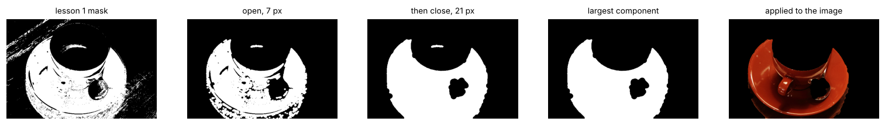
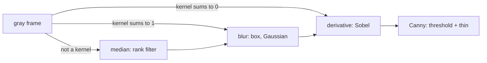
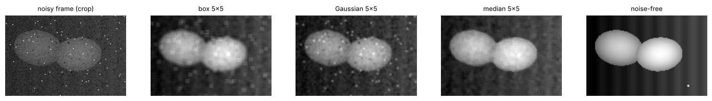
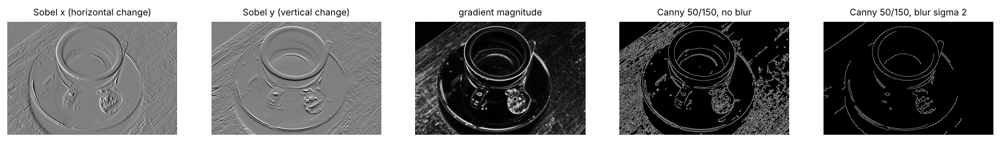
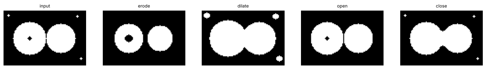
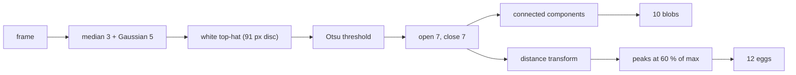
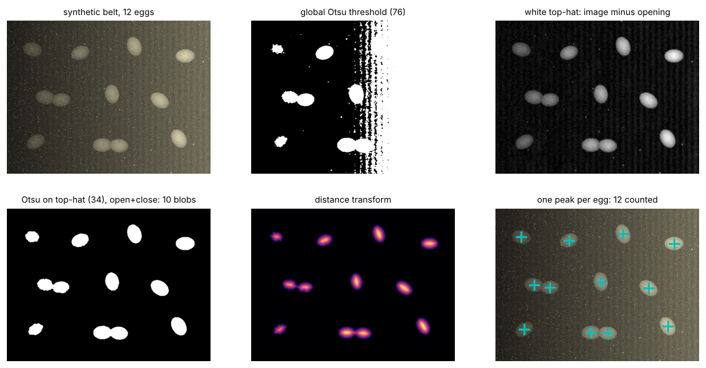

# Lesson 2 - Filtering, edges, morphology

*Every operation in this lesson looks at a pixel together with its neighbours. That is the whole difference from lesson 1, and it is what turns a noisy mask into a count.*

Lesson 1 ended with a saucer mask that was right in the large and wrong in the small: wood-grain streaks in the shadow, holes where the glaze reflected the lamp. A threshold cannot fix that, because it decides each pixel on its own value. This lesson's tools decide each pixel from a neighbourhood, in three families: **linear filters**, which average or differentiate; **edge detectors**, which are derivatives with a decision attached; and **morphology**, which reshapes binary masks. The worked example counts eggs on a conveyor belt with all three.

`lesson2.py` prints every number below and writes every figure to `figures/lesson2/`; it imports `lesson1.py`, so run it from the repository root. The belt image is **synthetic**: `make_belt()` draws twelve eggs from a fixed seed, so the true count is known and the pipeline can be scored rather than admired. Everything else uses `data/coffee.png`.

## 1. First, clean the lesson-1 mask

```python
raw = lesson1.saucer_mask_hue(rgb, 8).astype(np.uint8)
se = cv2.getStructuringElement(cv2.MORPH_ELLIPSE, (7, 7))
opened = cv2.morphologyEx(raw, cv2.MORPH_OPEN, se)
closed = cv2.morphologyEx(
    opened, cv2.MORPH_CLOSE, cv2.getStructuringElement(cv2.MORPH_ELLIPSE, (21, 21))
)
```



The raw mask covers 35.5 % of the image in 715 connected regions, 701 of them smaller than 50 pixels. **Opening** with a 7-pixel disc removes anything thinner than 7 pixels: 14 regions remain at 30.6 %, and the streaks are gone. **Closing** with a 21-pixel disc fills anything narrower than 21 pixels: the reflections on the glaze close up, 2 regions remain at 34.8 %. Keeping the largest connected component leaves one region of 83 224 pixels. Inside lesson 1's saucer patches the cleaned mask covers 94.1 % and 100 %; inside all three wood patches, 0.0 %.

Two things did not change. The dark blob in the middle is the spoon's bowl, wider than 21 pixels, so closing leaves it. The lower half of the cup, tinted red by the saucer, is still in the mask, because it is a *large, connected* error and morphology only fixes *small* or *disconnected* ones. Section 4 says exactly what "small" means. First, the linear filters, because morphology is easier once you have seen a kernel slide.

## 2. Filtering: a kernel slides over the image

A linear filter replaces each pixel by a weighted sum of its neighbourhood. The weights are a small array, the **kernel**; sliding it over the image and summing is **convolution** (OpenCV's `filter2D` computes correlation, which is identical for the symmetric kernels here).

```python
box = np.ones((5, 5), np.float32) / 25  # every entry 0.04, sums to 1
out = cv2.filter2D(gray.astype(np.float32), cv2.CV_32F, box, borderType=cv2.BORDER_REFLECT)
```

Three facts about kernels carry the lesson:

- **A kernel that sums to 1 averages; a kernel that sums to 0 differentiates.** The box sums to 1 and blurs. `[-1, 0, 1]` sums to 0: zero on flat regions, large on a step, a derivative. Every edge detector is a kernel of the second kind.
- **Output needs a wider type.** A derivative kernel produces negative values and a blur produces fractions. Compute in `float32` and convert back at the end, as lesson 1's `uint8` trap demands.
- **Borders have to be invented.** A 5 × 5 kernel centred on the top-left pixel needs two rows that do not exist. `BORDER_REFLECT` mirrors the image (OpenCV's default `BORDER_REFLECT_101` is a close cousin). Zero padding puts a dark frame round the image, and every edge detector finds it.

The **box** kernel weights every neighbour equally, smearing a sharp edge into a 5-pixel ramp. A **Gaussian** weights the centre most: the 5-tap kernel for σ = 1 is `[0.054 0.244 0.403 0.244 0.054]`, and the 2-D kernel is its outer product with itself. That product is why the Gaussian is cheap: a k × k kernel costs k² multiplies per pixel, two 1-D passes cost 2k, so 225 against 30 for k = 15. `cv2.GaussianBlur` does the two passes for you.

Neither helps with a dead pixel: a black pixel in a bright egg stays a dark smudge after any average, because an average is pulled by outliers. The **median** filter takes the middle value of the neighbourhood instead, and one outlier in 25 values never becomes the middle. The price is that the median is not linear, so the kernel reasoning above does not apply to it.



**Measured on the belt.** The synthetic frame has Gaussian sensor noise plus 1 % dead or saturated pixels, and `make_belt()` also returns the noise-free frame, so each filter's error can be measured directly:

| filter | mean error, all pixels | mean error, egg outlines |
|---|---|---|
| no filter | 8.67 | 9.24 |
| box 5 × 5 | 4.20 | 21.73 |
| Gaussian 5 × 5, σ = 1 | 4.54 | 18.29 |
| median 5 × 5 | 3.85 | 15.33 |
| median 3 × 3 then Gaussian | 3.86 | 18.92 |



Read the columns against each other. Over the whole frame every filter halves the error, and the box beats the Gaussian slightly because at σ = 1 it simply blurs more. On the egg outlines (pixels where the clean image's gradient is steep) every blur is *worse* than no filter at all, the box worst. Blurring trades edge sharpness for flatness, and the metric you pick decides which filter wins. The median does best on both because it damages edges less and removes the dead pixels outright: in the crop the box leaves square ghosts around each dead pixel, the Gaussian round ones, the median none.

## 3. Edges: a derivative, then a decision

An edge is where brightness changes quickly, so edge detection starts with a derivative. The **Sobel** kernels estimate the horizontal and vertical derivatives while smoothing across the other direction:

```python
sobel_x = np.array([[-1, 0, 1], [-2, 0, 2], [-1, 0, 1]], np.float32)
gx = cv2.filter2D(gray.astype(np.float32), cv2.CV_32F, sobel_x)
gy = cv2.filter2D(gray.astype(np.float32), cv2.CV_32F, sobel_x.T)
magnitude = np.hypot(gx, gy)
```

Walk along row 300 of the coffee image at its strongest horizontal change, column 359, where the saucer's bright rim meets its shadow. The gray values are `[182 253 254 236 125 118 169]` and Sobel x is `[302 231 -83 -461 -426 143 357]`: positive where the row brightens to the right, most negative (−461) where it drops from 236 to 125, near zero on the flat top. The magnitude reaches 939, far outside `uint8`, which is why the derivative lives in `float32`.



Sobel x finds vertical edges, Sobel y horizontal ones, and the magnitude finds both but is thick: a step gives a ridge two or three pixels wide, and the wood grain a haze of weak ridges everywhere. **Canny** turns the magnitude into one-pixel edges in three steps: keep only pixels that are a local maximum along the gradient direction (thinning); accept every pixel above a high threshold; accept pixels above a low threshold only if they connect to an accepted one (hysteresis). The low threshold lets a weak but continuous outline survive without admitting isolated weak pixels.

```python
edges = cv2.Canny(cv2.GaussianBlur(gray, (0, 0), 2.0), 50, 150)
```

| Canny thresholds | no blur | σ = 1 | σ = 2 |
|---|---|---|---|
| 50 / 150 | 13.04 % | 6.11 % | 2.05 % |
| 100 / 200 | 8.48 % | 3.35 % | 1.22 % |

The table is the share of pixels marked as edges. Raising the thresholds from 50/150 to 100/200 removes a third of them; blurring with σ = 2 first removes six sevenths. That asymmetry is the lesson. Thresholds decide how *strong* an edge must be, and wood grain is strong. Blur decides how *wide* a feature must be before it counts, and wood grain is narrow. So the order is always blur, then differentiate; `cv2.Canny` does no smoothing of its own beyond the Sobel kernel. Start with a high:low ratio of 2:1 or 3:1, and choose σ from the size of the detail you want to keep, not from the noise.

## 4. Morphology: reshaping a mask with a structuring element

Morphology operates on binary masks with a small shape called the **structuring element**, a disc here. Two primitives:

- **Erosion**: a pixel stays on only if the whole element fits inside the mask around it. Objects shrink, anything thinner than the element disappears, holes grow.
- **Dilation**: a pixel turns on if the element touches any on-pixel. Objects grow, gaps narrower than the element close, holes shrink.

Everything else is a composition. **Opening** is erosion then dilation: it deletes what the element cannot fit into, then restores the size of what survived. **Closing** is dilation then erosion: it fills what the element cannot fit into *in the background*, then restores the size. The toy below has two touching discs, a 5-pixel hole, and three 3-pixel specks; the element is a 5-pixel disc.



| operation | pixels on | regions | holes |
|---|---|---|---|
| input | 1 807 | 4 | 1 |
| erode | 1 337 | 2 | 1 |
| dilate | 2 324 | 4 | 0 |
| open | 1 785 | 2 | 1 |
| close | 1 848 | 4 | 0 |

Erosion loses 470 pixels, the specks and the neck between the discs, and the hole grows. Dilation gains 517, fills the hole, but keeps and fattens the specks. Opening ends 22 pixels short of the input with the specks and neck gone and the hole intact: it removed small *foreground*. Closing ends 41 pixels over with the hole filled and the specks intact: it removed small *background*. The sizing rule is now exact: **opening removes foreground narrower than the element, closing removes background narrower than the element, and neither changes what is wider**. That is why section 1 opened with 7 pixels (streaks are a few pixels wide) and closed with 21 (reflections are up to 20), and why the spoon survived.

Two more tools finish the kit. **Connected components** (`cv2.connectedComponentsWithStats`) labels each separate region and reports its area and bounding box; the table's regions and holes were counted with it. The **distance transform** replaces each foreground pixel by its distance to the nearest background pixel, so the centre of a convex blob is a peak and the neck between two touching blobs is a saddle. Section 5 counts with both.

## 5. Worked example: count the eggs on a belt

**Task.** Count the eggs in a frame from a camera over a conveyor belt. The frame has a lamp on the right, dirt on the belt, sensor noise and a few dead pixels, and two pairs of eggs touch. The true answer is 12.



**Step 1, denoise.** A 3 × 3 median removes the dead pixels, then a 5 × 5 Gaussian calms the sensor noise. The median alone scored slightly better in section 2, but the Gaussian gives Otsu's method a smoother histogram, and on 60-pixel eggs a σ of 1 costs nothing we need.

**Step 2, see the global threshold fail.** In the noise-free frame the belt is 36 at the left edge and 109 at the right; the leftmost egg is 90 and the rightmost 214. No single value separates egg from belt, because a dark egg is darker than lit belt. Otsu picks 76 and the second panel below shows 7 blobs, the largest 129 895 pixels: the lit half of the belt.



**Step 3, flatten the lighting with a top-hat.** The **white top-hat** is the image minus its opening. Opening a *grayscale* image with a disc larger than any egg erases the eggs and keeps the belt with its gradient, so subtracting it keeps the eggs and drops the belt. With a 91-pixel disc (1.5 egg diameters) the third panel is a flat dark background with bright eggs; the gradient is gone without being modelled. Otsu on the top-hat picks 34.

```python
se = cv2.getStructuringElement(cv2.MORPH_ELLIPSE, (91, 91))
tophat = cv2.morphologyEx(denoised, cv2.MORPH_TOPHAT, se)
_, mask = cv2.threshold(tophat, 0, 255, cv2.THRESH_BINARY | cv2.THRESH_OTSU)
```

**Step 4, clean and count.** Opening with 7 pixels removes the dirt specks, closing with 7 fills pinholes, and connected components with an area floor of 400 pixels gives 10 blobs. Their areas, sorted, are 1164, 1235, 1743, 1916, 1963, 2067, 2112, 2121, 2980 and 3678. The two dimmest eggs are smallest because the threshold takes their dark rims; the two largest are the touching pairs. An area rule ("over 1.5 × the median is two eggs") would catch 3678 and miss 2980, which is below 1.5 × 2015. Areas split blobs badly.

**Step 5, split touching eggs with the distance transform.** Inside one egg the distance to the background peaks once, at the centre, at about 22 pixels; inside a touching pair it peaks twice with a saddle at the neck. Keeping pixels at or above 60 % of the maximum leaves one spot per egg, and counting the spots gives 12.

```python
dist = cv2.distanceTransform(cleaned, cv2.DIST_L2, 5)
peaks = (dist >= 0.6 * dist.max()).astype(np.uint8)
n_eggs = cv2.connectedComponentsWithStats(peaks)[0] - 1  # 12
```

**What is fragile here.** The 60 % rule assumes the eggs are all about the size of the largest; one very large egg lowers the bar for the rest, and three eggs in a row make a saddle shallower than 40 %, which the rule would miss. The top-hat disc must exceed the largest egg or eggs are subtracted with the belt. The lamp gradient is assumed smooth; a hard shadow edge is a bright "object" to a top-hat. And this is a synthetic frame: real eggs have speckles and real belts have seams, so the next steps on real footage are a watershed from these peaks (`cv2.watershed`) and the tracking of exercise 4. The structure, though, is what every classical counter looks like: denoise, flatten, threshold, clean, label, split.

## Exercises

1. Apply the kernel `[1, −2, 1]` to the row `[10, 10, 10, 50, 50, 50]` with reflected borders. What does the result mark, and what does the kernel's sum tell you before you compute anything?
2. On the toy shape of section 4, predict what "open then close" and "close then open" with the 5-pixel disc each do to the specks, the hole and the neck. Then say when the two orders give different results.
3. The belt's dirt specks are up to 3 pixels across and the eggs are about 44 × 60 pixels. Why does section 5 open with 7 pixels rather than 3 or 45, and why not use erosion alone to remove the specks?
4. The belt moves and the camera gives 10 frames a second. Counting every frame and summing overcounts each egg many times. Describe a counting scheme that counts each egg once, using nothing beyond this lesson plus the centroids that `connectedComponentsWithStats` returns.
5. Using the Canny table of section 3: for the belt, where the eggs are 60 pixels across and the weave texture is 3 pixels wide, would you reach for σ = 2 or for thresholds of 100/200 to suppress the weave? What would each do to the egg outlines?

<details>
<summary>Answers</summary>

**1.** The kernel sums to 0, so it is a derivative (a second derivative, in fact) and returns 0 on any flat stretch. With reflected borders the row becomes `[10 | 10 10 10 50 50 50 | 50]` and the output is `[0, 0, 40, −40, 0, 0]`: a positive spike just before the step and a negative one just after. Zero crossings of the second derivative are another way to locate edges (the Laplacian of Gaussian detector does this in 2-D).

**2.** Open then close: opening deletes the specks and cuts the neck, closing refills the hole and, because the discs still touch, rejoins them: 1 827 pixels, one region, no hole (`lesson2.py` prints this). Close then open: closing fills the hole and keeps the specks, opening then deletes the specks and leaves the discs joined through the now-wider neck: also 1 827 pixels. They coincide because every feature here is far from every other. They differ when a speck lies within one element of the main region (closing first absorbs it; opening first deletes it) and when two regions are separated by a gap narrower than the element (closing first bridges it for good; opening first may widen it so no bridge forms).

**3.** Opening removes foreground narrower than the element and leaves wider foreground unchanged, so the element must be wider than the widest speck and narrower than the narrowest egg. 3 pixels equals the largest speck and would leave some; 45 exceeds the eggs' 44-pixel width, and `lesson2.py` confirms that opening the toy with 45 pixels leaves 0 pixels on. 7 is safely between. Erosion alone would also delete the specks but would shrink every egg by a 3-pixel ring, changing every area and outline; opening restores the size, which is the whole reason it exists.

**4.** Draw a counting line across the belt, perpendicular to travel. Each frame, compute the egg centroids as in section 5 and match each to the nearest centroid in the previous frame, within a distance set by the belt speed (at a known speed and 10 frames a second, an egg moves a fixed number of pixels per frame). Count a track once, when it crosses the line. Cases to handle: a track that vanishes before the line (merged with a neighbour) and reappears after it, and a dropped frame, which doubles the expected displacement.

**5.** σ = 2. The weave is a 3-pixel-wide *strong* contrast; thresholds of 100/200 remove only the weakest third of edges and the weave stays, because strength is not its problem. A Gaussian with σ = 2 averages over about 9 pixels (±2σ), flattening a 3-pixel pattern while a 60-pixel egg survives as a softer step. The cost: the outline shifts by a pixel or two, and the boundary between two touching eggs, weak anyway, may vanish. That is why section 5 finds eggs by region, not by outline.

</details>

## What to read next

- **Lesson 3** of this course: features and matching, where edges and corners become something you can find again in a second image, and a homography maps the belt plane to the floor plane.
- Szeliski, *Computer Vision: Algorithms and Applications*, 2nd ed. (free online), sections 3.2 (linear filtering), 3.3.1 (morphology, distance transforms) and 7.2 (edges).
- Canny, "A Computational Approach to Edge Detection", 1986, for the three criteria the detector optimises; hysteresis is in section VI.
- The OpenCV tutorials "Smoothing Images", "Morphological Transformations" and "Image Segmentation with Watershed Algorithm"; the last picks up where section 5 stops.
- Soille, *Morphological Image Analysis*, chapter 3, for the top-hat and the opening as set operations rather than recipes.
