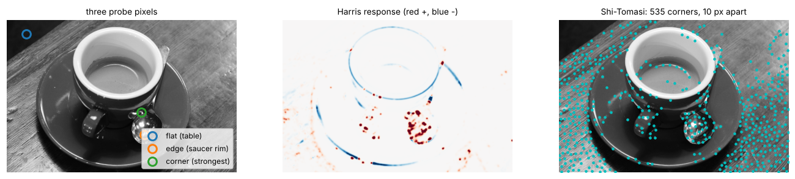
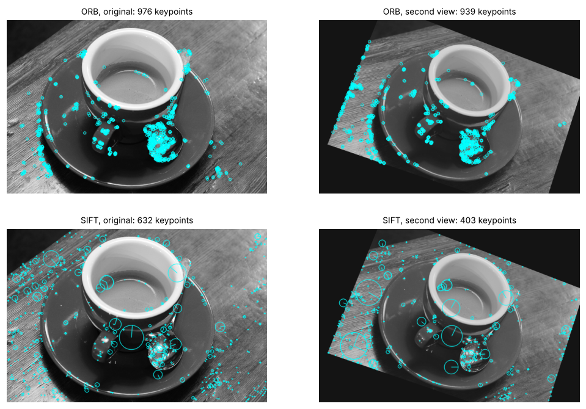
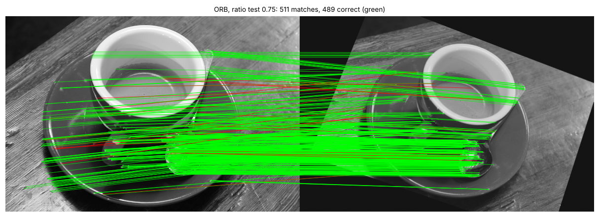
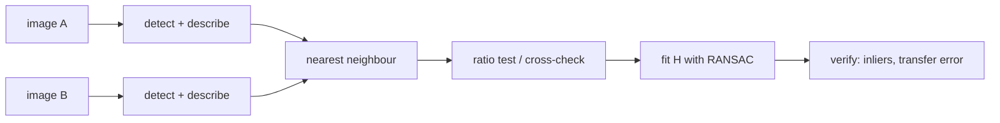
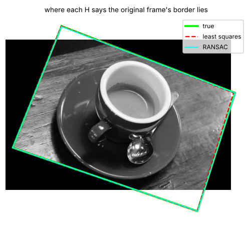
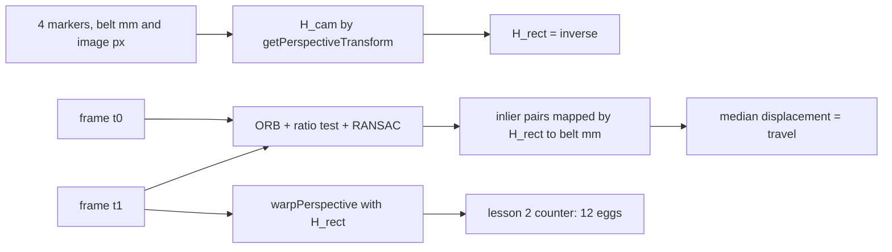
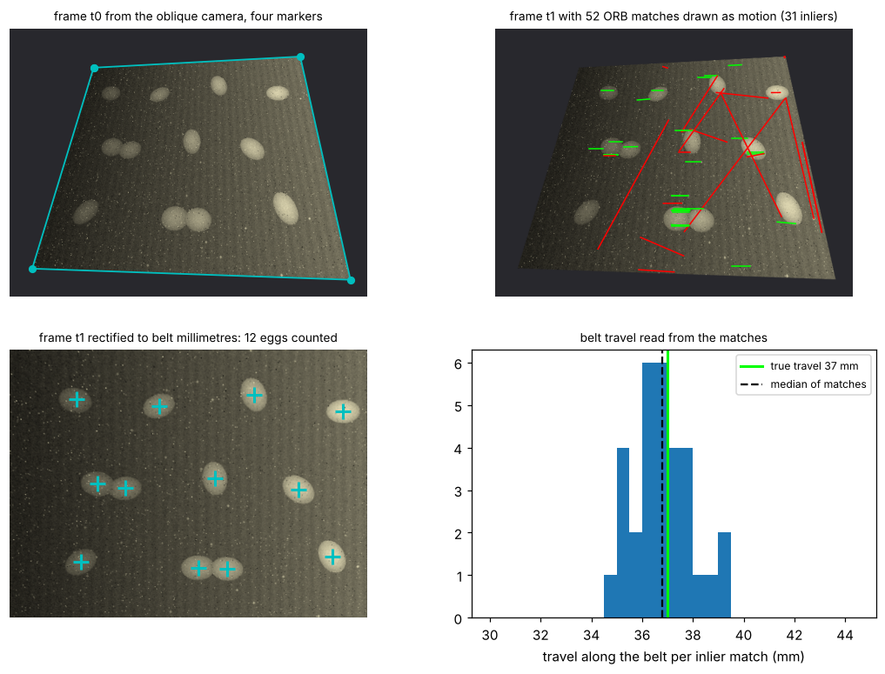

# Lesson 3 - Features and matching, homography

*Lesson 2 found edges. This lesson finds points you can find again in a second image, and uses them to measure how the two images are related.*

An edge is easy to detect and useless to match: slide along it and every position looks the same. A **feature** is a point that looks like itself from only one place, described so that the description survives a change of viewpoint and lighting and can be recognised in a second image. Once enough points are matched, a **homography** relates two views of a flat surface; with it you can rectify an oblique camera image into a top-down one, or measure how far something moved in real units. The worked example does both: it reads the travel of lesson 2's egg belt, in millimetres, from an oblique camera.

`lesson3.py` prints every number below and writes every figure to `figures/lesson3/`. Sections 1 to 4 warp `data/coffee.png` with a homography the script chooses, so every keypoint, match and estimated homography is scored against a known truth. Section 5 uses lesson 2's synthetic belt in two frames a moment apart; nothing here is a photograph of a real belt.

## 1. What makes a point findable: the structure tensor

Take a small window around a pixel and ask how much the image changes when the window is shifted. On a flat region, nothing changes. On an edge, the window changes when shifted across the edge but not along it. On a corner, it changes in every direction. The **structure tensor** turns that into two numbers. With the Sobel derivatives from lesson 2, sum the products over a Gaussian window:

```python
gx, gy, _ = lesson2.sobel(gray)
sxx = cv2.GaussianBlur(gx * gx, (0, 0), 2.0)
sxy = cv2.GaussianBlur(gx * gy, (0, 0), 2.0)
syy = cv2.GaussianBlur(gy * gy, (0, 0), 2.0)
M = np.array([[sxx[r, c], sxy[r, c]], [sxy[r, c], syy[r, c]]])
```

`M` is a 2 × 2 matrix at every pixel; its eigenvalues λ₁ ≥ λ₂ say how strongly the window changes along its two principal directions. Three probe pixels in the coffee image:

| pixel | λ₁ | λ₂ | Harris R |
|---|---|---|---|
| flat (table, row 35 col 50) | 16 | 9 | 121 |
| edge (saucer rim, row 300 col 359) | 99 388 | 13 013 | 7.9 × 10⁸ |
| corner (strongest, row 241 col 351) | 134 898 | 82 366 | 9.2 × 10⁹ |

The edge pixel is the one lesson 2 walked across: λ₁ is large (the rim is a strong step) and λ₂ nearly eight times smaller (along the rim, little changes). The corner has both large. Nobody computes eigenvalues per pixel; two shortcuts do the same job:

- **Harris** scores R = det M − k (tr M)² with k ≈ 0.04. Since det M = λ₁λ₂ and tr M = λ₁ + λ₂, R is large and positive only when both eigenvalues are large, negative on edges (one large eigenvalue makes the trace term win) and near zero on flat regions: red at corners, blue along the rims in the middle panel below.
- **Shi–Tomasi** keeps λ₂ alone, which is what `cv2.goodFeaturesToTrack` thresholds. Every pixel whose λ₂ is at least 1 % of the best, at least 10 pixels apart, gives 535 corners here.



In the right panel most of the 535 corners are on the wood grain and the crema, which have texture; few are on the smooth white cup. A detector finds *distinctive* points, not *interesting* ones. If the object you care about is smooth, matching leans on its surroundings, as section 5 finds on the eggs.

## 2. Describing a point so it can be recognised

A corner's position is not enough to match it; a second image has hundreds of corners. Each needs a **descriptor**: a vector computed from the patch around it, nearly the same for the same physical point in both images and different for different points. Two designs matter.

**ORB** detects FAST corners on an image pyramid, orients each by the intensity centroid of its patch, then compares 256 pixel pairs in the rotated patch, one bit per comparison: a 32-byte binary descriptor, compared by **Hamming distance**, the number of differing bits. **SIFT** finds blobs at their characteristic scale with a difference-of-Gaussians pyramid, orients each by its gradient histogram, and records gradient histograms in a 4 × 4 grid of cells with 8 directions each: 128 floats, compared by Euclidean distance. SIFT is slower and more precise; ORB runs on a phone or a small camera board.

```python
orb = cv2.ORB_create(nfeatures=1000)
kps, desc = orb.detectAndCompute(gray, None)  # desc.shape == (n, 32), uint8
sift = cv2.SIFT_create()
kps, desc = sift.detectAndCompute(gray, None)  # desc.shape == (n, 128), float32
```

To score them, the script makes a second view of the coffee image with a homography it chooses: rotate 20°, shrink to 0.85, shift by (30, 10) pixels, tilt slightly, then dim the lamp (contrast × 0.8, offset + 20). Because H is known, every keypoint of the original can be projected into the second view and checked for a keypoint within 3 pixels. That share is the **repeatability**.

| detector | keypoints, original | keypoints, second view | descriptor | repeatability |
|---|---|---|---|---|
| ORB | 976 | 939 | 32 × uint8 | 86.8 % |
| SIFT | 632 | 403 | 128 × float32 | 45.5 % |



The SIFT row looks bad and is worth understanding. Without the dimming, SIFT finds 531 keypoints and repeats 59.9 %, ORB 87.6 %. SIFT's contrast threshold is absolute, so dimming by 20 % drops its weakest blobs, and shrinking by 15 % moves blobs between scale levels. ORB has no absolute threshold, it keeps the strongest corners up to its cap, and FAST corners sit on fine detail that a 3-pixel test rewards. Repeatability counts points, not precision; section 4 shows SIFT winning on precision.

## 3. Matching: nearest neighbour, then two filters

Matching is a search: for each descriptor in A, find the closest in B. `cv2.BFMatcher` does it exhaustively, fast enough for 1 000 × 1 000. The trouble is that *every* descriptor has a nearest neighbour, including those whose true partner is hidden or out of frame.

```python
bf = cv2.BFMatcher(cv2.NORM_HAMMING)
nearest = bf.match(desc_a, desc_b)  # one pair per descriptor in A
two = bf.knnMatch(desc_a, desc_b, k=2)  # the two nearest in B
ratio = [m for m, n in two if m.distance < 0.75 * n.distance]
cross = cv2.BFMatcher(cv2.NORM_HAMMING, crossCheck=True).match(desc_a, desc_b)
```

A pair is correct if the true H sends its A point within 3 pixels of its B point:

| detector / matcher | matches | correct | precision |
|---|---|---|---|
| ORB / nearest neighbour | 976 | 712 | 73.0 % |
| ORB / ratio test 0.75 | 511 | 489 | 95.7 % |
| ORB / cross-check | 543 | 498 | 91.7 % |
| SIFT / nearest neighbour | 632 | 209 | 33.1 % |
| SIFT / ratio test 0.75 | 212 | 199 | 93.9 % |
| SIFT / cross-check | 236 | 204 | 86.4 % |

**Lowe's ratio test** keeps a pair only if the nearest descriptor is clearly nearer than the second nearest (by a factor of 0.75 here). A point on repeated texture, such as the wood grain, has several look-alikes in B at similar distances and fails; a point with one true partner passes. The **cross-check** keeps a pair only if B's nearest in A is the same point, removing many-to-one matches. The ratio test costs more matches and buys more precision: for ORB, 465 pairs thrown away to go from 73 % to 96 %.

The raw precision gap between the detectors is in the distances. For ORB, correct pairs have a median Hamming distance of 25 bits and wrong pairs 61; two random 256-bit strings would differ in 128, and the nearest of 939 candidates is always much closer than random. For SIFT the medians are 70 against 299, a wider gap, but its 45 % repeatability means over half of its keypoints have no true partner, so their nearest neighbour is wrong whatever the distance. A matcher cannot fix a detector.





## 4. The homography: eight numbers that relate two views of a plane

A homography is a 3 × 3 matrix H that maps (x, y) to (x', y') through homogeneous coordinates: multiply [x, y, 1]ᵀ by H and divide by the third component. It is exact for two pictures of a **flat surface** from any two camera positions, and for any scene if the camera only rotated. Scaling H changes nothing, so it has 8 degrees of freedom and the script normalises H[2, 2] = 1. Each correspondence gives two equations, so four fix H exactly: the **direct linear transform**, which `cv2.getPerspectiveTransform` computes.

```python
H4 = cv2.getPerspectiveTransform(src4, dst4)  # exactly 4 pairs
H_ls, _ = cv2.findHomography(src, dst, 0)  # least squares, every pair
H_ra, mask = cv2.findHomography(src, dst, cv2.RANSAC, 3.0)  # RANSAC, then re-fit on inliers
```

Four points are enough in principle and terrible in practice. The script picks four *correct* ORB matches at random, fits H, and measures where it sends the original frame's corners compared with the true H: over 200 trials the worst corner error has a median of 207 pixels. Each match is correct to within 3 pixels, but four points close together, or nearly in a line, extrapolate that error to the far corners enormously. With SIFT's sub-pixel keypoints the median is 7 pixels, still useless.

A least-squares fit over every ratio-tested pair is better and still wrong, because 22 of the 511 ORB pairs are outliers and each one pulls. **RANSAC** fits H from four random pairs, counts how many other pairs agree with it to within 3 pixels, repeats, keeps the H with the most agreement and re-fits it from all its inliers:

| fit | pairs | corner error, mean | corner error, max |
|---|---|---|---|
| ORB, least squares | all 511 | 1.57 px | 4.29 px |
| ORB, RANSAC | 490 inliers | 0.61 px | 1.30 px |
| SIFT, least squares | all 212 | 1.45 px | 2.26 px |
| SIFT, RANSAC | 199 inliers | 0.17 px | 0.22 px |



Two things to take from the table. RANSAC drops a few per cent of the pairs and cuts the error by a factor of three to ten, so the outliers mattered far more than their number suggests. And SIFT's 199 matches give a homography three to six times more precise than ORB's 490, because each SIFT keypoint is localised to a fraction of a pixel while FAST corners sit on integer pixels. More matches are not better matches.

The corner error here is a **transfer error** against the true H. In real work there is no true H; what you can compute and report is the inlier count and the inliers' reprojection error. Many inliers spread over the whole overlap make a trustworthy homography; 30 clustered on a few objects make a guess, as the next section shows.

## 5. Worked example: belt travel from an oblique camera

**Task.** The camera over lesson 2's belt is mounted at an angle, so the belt is a trapezoid in the image and far eggs are smaller than near ones. Measure how far the belt moves between two frames, in millimetres. Four markers at the corners of a 640 × 480 mm section of belt are visible, and their image positions have been clicked once.

In the script the two frames come from `lesson2.make_belt()`, the belt rolled 37 pixels to the right in the second (1 pixel = 1 mm) under the same stationary lamp with fresh sensor noise, both then warped by a chosen camera homography. The truth is 37 mm; the camera is fiction.



**Step 1, calibrate from the markers.** Four correspondences, belt millimetres to image pixels, fix H_cam exactly, and its inverse H_rect maps image pixels to belt millimetres:

```python
belt_mm = np.float32([[0, 0], [640, 0], [640, 480], [0, 480]])
markers_px = np.float32([[150, 70], [520, 50], [610, 450], [40, 430]])
H_cam = cv2.getPerspectiveTransform(belt_mm, markers_px)
H_rect = np.linalg.inv(H_cam)
topdown = cv2.warpPerspective(frame, H_rect, (640, 480))
```

**Step 2, see why rectification matters.** Lesson 2's counter run directly on the oblique frames finds 9 and 10 eggs: its top-hat disc, opening sizes and distance-transform rule were chosen for 60-pixel eggs, and in the oblique image a 60 mm egg is 35 to 53 pixels long depending on where it lies. On the rectified frames it finds 12 and 12. Nothing in the counter changed; the image was brought back to the geometry it was designed for.



**Step 3, match features between the frames.** ORB on the two oblique frames, ratio test, RANSAC: 52 matches, 31 inliers. The number is low because the scene is smooth: the eggs have no corners and the belt weave is repetitive, so the ratio test discards it, leaving dirt specks and egg rims. A feature count is a property of the scene before it is a property of the detector.

**Step 4, read the travel in belt millimetres.** Map both ends of every inlier pair through H_rect and subtract. The median displacement along the belt is 36.79 mm, across it 0.40 mm; the truth is 37 and 0. The inliers range from 34.5 to 39.2 mm: a pixel or two of keypoint error in the image, magnified by the camera's scale (one image pixel is 1.1 mm of belt at the near edge, 1.7 mm at the far edge), and the median absorbs it.

```python
src_mm = cv2.perspectiveTransform(src_px.reshape(-1, 1, 2), H_rect).reshape(-1, 2)
dst_mm = cv2.perspectiveTransform(dst_px.reshape(-1, 1, 2), H_rect).reshape(-1, 2)
travel_mm = np.median((dst_mm - src_mm)[inliers], axis=0)  # [36.79, 0.40]
```

**Step 5, compare with the full homography.** The RANSAC homography between the frames, expressed in belt coordinates as H_rect · H · H_cam, should be a pure translation of (37, 0). It comes out with scales 0.986 and 0.994 and a translation of 37.5 mm along, 2.1 mm across: 31 inliers clustered on a dozen eggs do not pin down eight parameters, and the spare freedom becomes a spurious sideways drift. The median displacement estimates *one* parameter, the only one we know moves. Fit the model with the fewest parameters your knowledge of the setup allows.

**Step 6, close the loop with the eggs.** Rectify both frames, count with lesson 2, and pair each egg with the nearest egg in the next frame: the median travel is 36.67 mm, but 2 of the 12 pairs are more than 5 mm off. In each touching pair the leading egg's nearest neighbour in the next frame is its partner's new position, 13 to 15 mm ahead, not its own, 37 mm ahead. Pair each egg instead with the egg nearest to *where the features say it should be*, its old position plus 36.79 mm, and all 12 pairs are right, spread 2.04 mm. Lesson 2's exercise 4 made concrete: features give the belt speed, and the speed makes centroid tracking unambiguous.

**What is fragile here.** A homography describes a plane. A real egg stands roughly 20 mm proud of the belt, so its image position is not that of a belt-plane point; the error is the same in both frames and cancels in a displacement, but not in a position. The markers are assumed exact; exercise 4 measures a 2-pixel click error. On a real belt, with speckled eggs and a real weave, the feature count changes, up or down; the pipeline does not.

## Exercises

1. The structure tensor at some pixel has eigenvalues (λ₁, λ₂) = (80 000, 400). Corner, edge or flat? What sign is its Harris response with k = 0.04, and why does Shi–Tomasi reach the same verdict without a k?
2. Two random 256-bit ORB descriptors differ in 128 bits on average, with a standard deviation of 8. Yet the median distance of the *wrong* nearest-neighbour pairs in section 3 was 61. Explain, and say what this implies for a fixed distance threshold as the number of keypoints in image B grows.
3. Section 5's camera homography is exact for the belt surface. Suppose instead the camera moved sideways between the frames and the belt stood still. Would a homography still relate the two frames? Would it if the camera had only turned on its mount? Answer in terms of what a homography assumes.
4. `lesson3.py` perturbs the four clicked markers by up to 2 pixels in 200 trials. The belt's centre point moves by up to 3.5 mm in belt coordinates, but the measured travel changes by at most 0.25 mm. Why is a displacement so much less sensitive to calibration error than a position?
5. Frames arrive at 10 per second and the belt may run at anything between 0.2 and 0.8 m/s. How would you use the feature-based travel to make lesson 2's exercise-4 counting line robust to speed changes, and what would you do in a frame where RANSAC returns fewer than 10 inliers?

<details>
<summary>Answers</summary>

**1.** An edge: one eigenvalue 200 times the other. R = λ₁λ₂ − k(λ₁ + λ₂)² = 3.2 × 10⁷ − 0.04 × (80 400)² ≈ 3.2 × 10⁷ − 2.6 × 10⁸, negative. Harris needs k so the trace term outweighs the product on edges; Shi–Tomasi looks only at λ₂ = 400, tiny against what a corner reaches (82 366 in section 1), and rejects the pixel directly.

**2.** The 128 ± 8 figure is for one random pair. The wrong nearest neighbour is the *minimum* over 939 candidates, which for that many draws sits more than 3σ below the mean, near 100; real descriptors are far from independent random bits, so look-alikes are closer still, 61 here. As B gains keypoints the wrong nearest neighbour gets closer, so a fixed threshold that works at 1 000 keypoints admits wrong pairs at 10 000. The ratio test compares each pair with its own runner-up, which scales with the crowd.

**3.** A homography relates two images of the *same plane*, or any two images from a camera that *rotated about its centre* without moving. The belt is a plane, so a sideways camera move still gives a homography for belt points, but not for the egg tops, which are off the plane and show parallax against it (section 5's "fragile" caveat). If the camera only turned, every point in the scene obeys one homography, on the plane or not, because depth does not matter when the optical centre stays put.

**4.** Calibration error is a smooth distortion of the map from image to belt: a slightly wrong scale, shear or perspective. A position inherits the whole distortion at that point. A displacement is the difference of two positions a short way apart, so it inherits only the *change* in the distortion across 37 mm, roughly the error times the ratio of displacement to belt size (37/640 ≈ 6 %), which is how 3.5 mm becomes 0.25 mm. Hence measure travel from many short matches and a median, not from two points far apart.

**5.** Each frame, estimate the travel as in step 4 and use it as the predicted displacement for pairing centroids as in step 6, with the match radius a fraction of the predicted travel. A track is counted when its predicted position crosses the line, so the line works at any speed. With too few inliers (no specks in view, motion blur), do not trust that frame's travel: carry forward a running median of recent values and flag the frame; if it persists for several frames, the camera or lighting has changed and the count should stop rather than guess.

</details>

## What to read next

- **Lesson 4** of this course: from classical detection to CNNs, where this lesson's hand-designed descriptor is replaced by filters a network learns.
- Szeliski, *Computer Vision: Algorithms and Applications*, 2nd ed. (free online), sections 7.1 (points and patches) and 8.1 (2-D transformations, RANSAC).
- Harris and Stephens, "A Combined Corner and Edge Detector", 1988, for where R = det − k tr² comes from; Shi and Tomasi, "Good Features to Track", 1994, for why λ₂ alone is enough.
- Lowe, "Distinctive Image Features from Scale-Invariant Keypoints", 2004, sections 3 to 6 and 7.1 (the ratio test and the histogram behind 0.8); Rublee et al., "ORB: an efficient alternative to SIFT or SURF", 2011.
- Hartley and Zisserman, *Multiple View Geometry*, chapter 4, for the DLT, coordinate normalisation and RANSAC's stopping rule; the OpenCV tutorial "Feature Matching + Homography to find Objects" is this pipeline in 40 lines.
