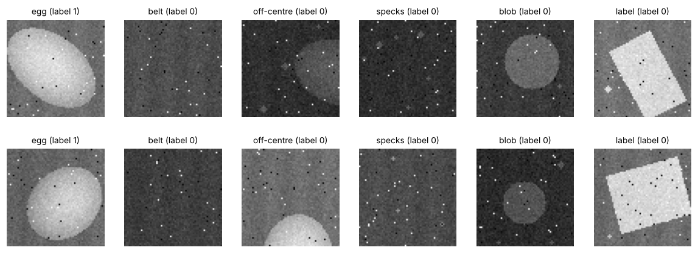
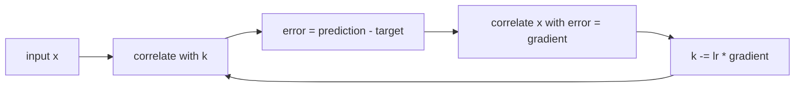
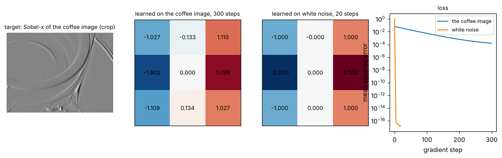
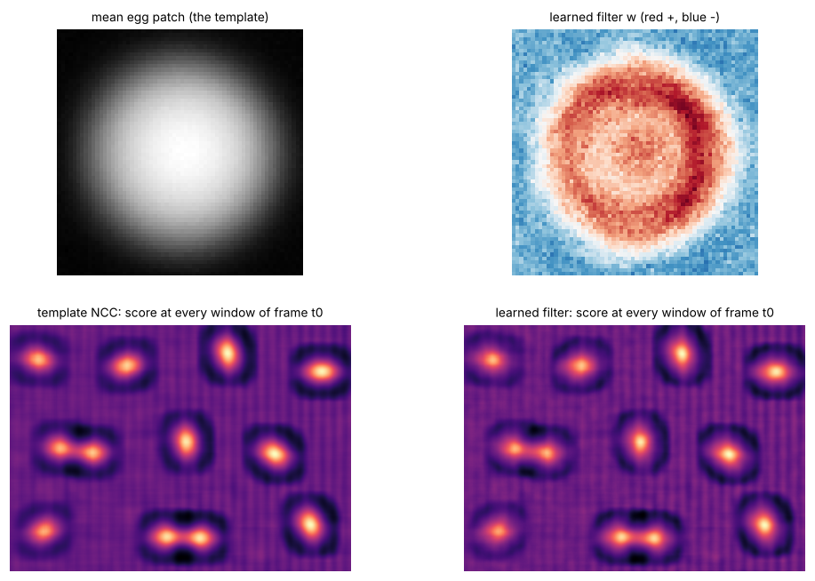
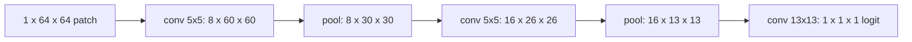
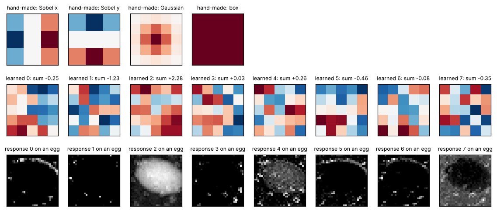

# Lesson 4 - Classical detection to CNNs: what a convolution learns

*Lessons 2 and 3 used filters and descriptors that someone designed by hand. This lesson lets the data design them, one step at a time, until the result is a small convolutional network that finds eggs in a frame.*

Every filter so far was written down: Sobel's nine numbers, ORB's 256 pixel pairs, the top-hat disc. They work because a person understood what an edge or a corner looks like and wrote it as arithmetic. A convolutional neural network (CNN) is the same arithmetic with the numbers left blank, then filled in by gradient descent on labelled examples. The lesson walks the whole distance: a hand-made template detector, a learned 3 × 3 kernel so that "learning a filter" is nine numbers you can watch, one learned 64 × 64 filter, a network of small filters, and the network run over a whole frame as a detector. Each step keeps the previous step's scoring.

`lesson4.py` prints every number below and writes every figure to `figures/lesson4/`. Everything is trained and scored on synthetic patches and on lesson 2's synthetic belt, where the answer is known.

## 0. Patches with a known label

A detector needs examples. `make_patch_set()` renders 64 × 64 grayscale patches with lesson 2's rules (belt with a faint weave, shaded egg ellipses, dirt specks, a lamp at a random level between 0.3 and 1.0, Gaussian noise, dead and hot pixels). Half are an **egg** centred within 6 pixels of the middle, with random size (52 to 68 by 38 to 48 pixels) and orientation. The other half are not an egg at that place: plain **belt**, an **off-centre** egg whose centre is 26 to 44 pixels away, **specks** of dirt, a bright flat **blob** 20 to 36 pixels across, and a bright **label**, a rectangle the size and brightness of an egg with corners instead of a curve. The training set has 4 000 patches (2 000 eggs, 300 belt, 600 off-centre, 300 specks, 400 blobs, 400 labels), the validation set 1 000 from a different seed. Nothing below is tuned on the validation set.



The negatives are the whole design: a classifier only learns to reject what it is shown, so "what might be mistaken for an egg?" must be answered before training.

## 1. Detection is classification at every window

The classical detector is a **template**: the average of the 2 000 egg patches. To test a window, compute its **normalised cross-correlation** (NCC) with the template: subtract each one's mean, divide by each one's standard deviation, multiply and sum. The normalisation removes lamp level and contrast, so a dim egg and a bright egg score alike, between −1 and 1.

```python
template = train.x[train.y == 1].astype(np.float32).mean(axis=0)
score_map = cv2.matchTemplate(frame, template, cv2.TM_CCOEFF_NORMED)  # one score per window
```

A score needs a threshold. The script sweeps every cut between two consecutive sorted training scores and keeps the one that classifies most training patches correctly: 0.582, with 86.1 % training accuracy and 87.2 % on validation. To turn window scores into detections, keep positions above the threshold that are the maximum within 24 pixels (**non-maximum suppression**, a dilation of the score map, as lesson 2's distance-transform peaks were) and read each centre as the window's corner plus 32. A detection within 15 pixels of a true centre counts as that egg; each egg can be claimed once, strongest detection first.

On validation patches the template is perfect on belt, off-centre eggs and specks, 78 % on blobs and 44 % on labels: a bright rectangle correlates with a blurry bright ellipse about as well as an egg does.

## 2. What "learning a kernel" means, in nine numbers

Before learning a detector, learn something whose answer you know. Take the coffee image (centred, so its mean is zero), compute its Sobel-x response with lesson 2's kernel, then forget the kernel: can nine numbers be recovered from input and output alone?

The model is `pred = correlate(x, k)`, the loss is the mean squared difference from the target, and the gradient with respect to each kernel entry is the mean of the error times the input pixel that entry multiplied. That gradient is itself a correlation of the image with the error image, which is why convolution layers are cheap to train: the backward pass is the forward pass's operation.

```python
def kernel_gradient(x, err, size):
    h, w = err.shape
    grad = np.empty((size, size), np.float32)
    for u in range(size):
        for v in range(size):
            grad[u, v] = 2.0 * np.mean(err * x[u : u + h, v : v + w])
    return grad


k = np.zeros((3, 3), np.float32)
for _ in range(300):
    err = correlate_valid(x, k) - target
    k -= lr * kernel_gradient(x, err, 3)
```



The step size comes from the curvature: the loss is a quadratic bowl in the nine entries, its 9 × 9 matrix of second derivatives is twice the covariance of a window's nine pixels, and the largest step that cannot diverge is one over its largest eigenvalue, 1.12 here. After 300 steps the kernel is

```
[[-1.027, -0.133,  1.110],
 [-1.802,  0.000,  1.799],
 [-1.109,  0.134,  1.027]]
```

recognisably Sobel-x and still 0.20 off in the worst entry; after 1 000 steps it is 0.06 off. The same procedure on an image of white noise reaches Sobel-x to four decimals in 20 steps.



The difference is in the curvature. For white noise the nine pixels of a window are independent, every direction in kernel space curves alike (largest over smallest eigenvalue: 1) and one step size fits all. In a photograph neighbouring pixels are nearly equal, so the data barely distinguish `k[0, 1]` from `k[1, 1]`: the bowl is 741 times flatter in that direction than in its steepest, and a step that is safe for the steep direction crawls along the flat one. This fact is behind centred and whitened inputs, batch normalisation, and optimisers such as Adam that scale each parameter's step by its own history. With nine unknowns and 238 004 equations there is no need to descend at all; a least-squares solve returns Sobel-x to 10⁻⁹ on both images. Networks descend because they have millions of unknowns and the loss is not a bowl.

## 3. One learned filter

Now learn a filter for the task rather than for a target image. **Logistic regression** on the standardised 64 × 64 patch is exactly one 64 × 64 correlation filter `w` plus a bias, with a sigmoid to turn the score into a probability. Full-batch gradient descent on the cross-entropy, 400 steps: training accuracy 89.4 %, validation 89.3 %.



The learned `w` (top right) is not the template (top left), though they point in similar directions (cosine 0.89). The template is the *average* egg: bright centre fading to the rim. The filter is *discriminative*: its strongest positive weights are a ring where an egg's rim falls, its centre is weaker, and everything outside the ring is negative. It asks for a bright region of a particular extent with a dark surround, which is what separates eggs from off-centre eggs and from blobs (rejected 90 % of the time, against the template's 78 %). On labels it does worse, 19 %, and no amount of training will fix it: a filter is linear in the pixels, and a rectangle and an ellipse of the same size and brightness differ only in the corners, which move with the orientation. No single weighted sum is large for all rotated ellipses and small for all rotated rectangles.

Running `w` over a whole frame is three correlations: `w` against the frame, and a 64 × 64 box against the frame and its square for each window's mean and standard deviation. The two score maps in the figure's bottom row are almost the same picture, and both show each touching pair of eggs as a dumbbell with two peaks, which NMS at 24 pixels resolves since the centres are 50 pixels apart.

## 4. A small convolutional network

A CNN replaces the one 64 × 64 filter with many small ones applied everywhere, a nonlinearity between layers, and pooling that keeps the strongest response in each 2 × 2 block:

```python
class EggNet(nn.Module):
    def __init__(self):
        super().__init__()
        self.conv1 = nn.Conv2d(1, 8, 5)  # 8 filters of 5 x 5 on the gray input
        self.conv2 = nn.Conv2d(8, 16, 5)  # 16 filters of 5 x 5 x 8 on the 8 response maps
        self.head = nn.Conv2d(16, 1, 13)  # the classifier: one 13 x 13 x 16 filter
        self.pool = nn.MaxPool2d(2)

    def forward(self, x):
        x = self.pool(torch.relu(self.conv1(x)))  # 64 -> 60 -> 30
        x = self.pool(torch.relu(self.conv2(x)))  # 30 -> 26 -> 13
        return self.head(x)  # 13 -> 1: the logit
```



It has 6 129 parameters, against the single filter's 4 097, trained with Adam for 16 passes over the 4 000 patches, batches of 64, a fixed seed, no augmentation. Validation accuracy climbs from 86.6 % after one pass to 98.9 % after 16, not monotonically (94.1 % at pass 9, 93.3 % at pass 10): a run this short on data this small is noisy. It rejects 95 % of the labels.

| detector | all | egg | belt | off-centre | specks | blob | label |
|---|---|---|---|---|---|---|---|
| template NCC | 87.2 % | 90.0 % | 100 % | 100 % | 100 % | 78.0 % | 44.0 % |
| learned filter | 89.3 % | 96.8 % | 100 % | 100 % | 100 % | 90.0 % | 19.0 % |
| CNN | 98.9 % | 98.8 % | 100 % | 100 % | 100 % | 100 % | 95.0 % |

Four ideas make the difference:

- **Locality.** A 5 × 5 filter sees 25 pixels: not an egg, only a small piece of one, and small pieces are shared between eggs of every size and orientation.
- **Weight sharing.** The same 25 numbers are applied at every position, where a layer connecting every input pixel to every output position would need millions (exercise 1). Sharing also makes the response move with the object, which section 5 relies on.
- **Stacking with a nonlinearity.** `relu` keeps positive responses and zeroes the rest. Without it two stacked convolutions collapse into one larger convolution, section 3's filter with extra steps. With it, the second layer sees *which* first-layer patterns fired where, and can build a rim out of edges.
- **Pooling.** Max over 2 × 2 blocks halves the resolution and forgives a pixel of shift. Two pools give the head a 13 × 13 grid of part responses, and the head is a linear template over that grid: the classical detector again, one level up.

What did the first layer learn? The figure shows the eight 5 × 5 filters next to Sobel-x, Sobel-y, a Gaussian and a box, each with its response to an egg patch underneath.



They are not textbook kernels; 4 000 patches and 16 passes leave them rough. But lesson 2's rule sorts them: a kernel whose entries sum to zero differentiates, one whose entries sum to a positive number averages. Filter 2 sums to +2.28 (0.70 of its total magnitude) and its response is the egg itself, smoothed: a blur used as a brightness detector. Filters 3 and 6 sum to +0.03 and −0.08 and respond only along the egg's outline: derivatives. Nobody told the network about edges; the labels did.

## 5. Worked example: the patch classifier as a detector

**Task.** Count the eggs on three belt frames: lesson 2's frame, lesson 3's second frame, and a third with different dirt plus three bright labels and two flat blobs placed by hand between the eggs. Then do it again with the camera further away.

**Step 1, run the network on the whole frame.** `EggNet` has no fully connected layer and no padding, so it accepts an image of any size. On the 480 × 640 frame the output is a 105 × 145 map of logits at a stride of 4 pixels, and entry (i, j) is *exactly* the logit the network gives the 64 × 64 window whose corner is at (4i, 4j): the script checks entry (30, 40), −7.7921 both ways. Section 1's sliding window has become one forward pass, the early layers' work shared between overlapping windows. That is the fully convolutional trick, and why detectors are built from convolutions.

```python
logits = net(torch.from_numpy(frame).float()[None, None] / 255)[0, 0]  # (105, 145)
dets = detect_peaks(logits.numpy(), threshold=0.0, stride=4)  # same NMS as the template
```

**Step 2, score all three detectors on all three frames.**

| frame | template NCC | learned filter | CNN |
|---|---|---|---|
| t0 (lesson 2) | 12 found, 0 false | 12 found, 0 false | 12 found, 0 false |
| t1 (lesson 3) | 12 found, 0 false | 12 found, 0 false | 12 found, 0 false |
| t2 (three labels, two blobs) | 12 found, 3 false | 12 found, 3 false | 12 found, 0 false |


On frames of eggs and dirt every detector is perfect: bright ovals on a dark belt are an easy target, which lesson 2's top-hat and Otsu found without training. The third frame is where the detectors part. The template and the learned filter circle every label; the CNN circles none, and nobody is fooled by the blobs. The 95 % on label patches became 0 false alarms on 3 labels, which is three draws, not a measurement; the patch table is the number to quote.

**Step 3, change the distance.** Shrink frame t0 so the eggs are 0.8, 0.6 and 0.5 of their trained size, and run everything unchanged:

| eggs at | template NCC | learned filter | CNN |
|---|---|---|---|
| 0.8 × | 12 of 12 | 12 of 12 | 12 of 12 |
| 0.6 × | 8 of 12 | 7 of 12 | 11 of 12 |
| 0.5 × | 5 of 12 | 2 of 12 | 10 of 12 |

All three know one size. The CNN degrades most slowly because its parts are small and its pooling forgives some displacement of them, but at half size it misses two, and in the figure's last row the learned filter's two "detections" sit on the midpoints of the touching pairs: at half size a pair is the length of one trained egg. The remedy is the last column of the script's table. Resize each shrunk frame back up to the trained scale and every detector finds 12 of 12 with no false alarms, at all three scales. The resized image carries no more information than the small one; the detector is simply asked the question it was trained on. Run a fixed-size detector on a stack of resized copies, the **image pyramid**, and it is a multi-scale detector; lesson 6's detector does this inside its network.

**What is fragile here.** Everything was rendered by the same code that rendered the training data, so the 98.9 % says the network learned the generator, not eggs. The labels are an invented negative; real belts have their own, and whatever is not in the training set is not rejected on purpose. Four thousand patches and no augmentation leave the filters rough and the validation curve noisy; a different seed gives a different last-epoch number, so `tests/test_lesson4.py` pins ranges, not digits. And 95 % on labels means five of the hundred validation labels still pass: a label in every frame is a false count every twenty frames.

## Exercises

1. Count `EggNet`'s parameters layer by layer. Then count the weights of a *fully connected* layer that maps the 64 × 64 input to the same 8 × 60 × 60 output as `conv1`.
2. The logit map on a 480 × 640 frame is 105 × 145 at stride 4. Derive both numbers from the layer sizes. What would the map be with a third `pool` before the head (adjust the head so a 64 × 64 patch still gives one number)? What breaks in the "exactly the same logit" check if the convolutions used `padding=2`?
3. If the lamp were twice as bright, what happens to each first-layer filter's response and to the `relu` outputs? The training lamp levels were 0.3 to 1.0 and the frame's lamp runs from 0.30 at the left edge to 1.0 at the right; where would a CNN with no normalisation fail first if the lamp dimmed, and why did the template not have this problem?
4. Section 2's gradient descent needed 1 000 steps on the photograph and 20 on noise. What could you do to the *input* image to make the photograph behave like the noise, and what has that to do with `standardise()`?
5. In frame t2 the CNN rejects all three labels, but on validation patches it rejects 95 of 100. If labels appear in 5 % of windows and eggs in 1 %, what fraction of the detector's alarms will be labels? What would you add to the training set, and measure, before trusting the count?

<details>
<summary>Answers</summary>

**1.** `conv1`: 8 × (5 × 5 × 1) + 8 biases = 208. `conv2`: 16 × (5 × 5 × 8) + 16 = 3 216. `head`: 13 × 13 × 16 + 1 = 2 705. Total 6 129. A fully connected layer from 4 096 inputs to 8 × 60 × 60 = 28 800 outputs has 4 096 × 28 800 ≈ 118 million weights, 19 000 times more.

**2.** Rows: 480 → 476 after `conv1` (no padding loses 4) → 238 pooled → 234 after `conv2` → 117 pooled → 117 − 13 + 1 = 105. Columns: 640 → 636 → 318 → 314 → 157 → 145. Each pool doubles the stride. A third pool (117 → 58, 157 → 78) with a 6 × 6 head (64 → 60 → 30 → 26 → 13 → 6, the odd row dropped) gives 53 × 73 at stride 8. With `padding=2` the patch run pads its border with zeros while the frame run sees real neighbours there, so the two logits differ at every window.

**3.** Every convolution is linear, so doubling the input doubles every response and every `relu` output; only the biases do not scale, so the pattern of which units fire shifts a little. Below the trained range (the left edge, if the lamp dims to 0.2) the network has never seen weak responses against unchanged biases and may misfire; the template never had the problem because NCC divides each window by its own standard deviation, as `standardise()` does to patches. Networks get the same protection from a normalisation layer.

**4.** Whiten it: remove the correlation between neighbouring pixels. Subtracting the mean (done) removes the largest eigenvalue; high-pass filtering (subtracting a blurred copy) flattens the rest, and descent on the whitened image converges like the noise case. `standardise()` is the whole-patch version: one step size then suits every patch. Batch normalisation does the same between layers.

**5.** Per 100 windows: 5 labels × 5 % = 0.25 false alarms, 1 egg × 98.8 % = 0.99 true ones, so about one alarm in five is a label. Add labels of the kinds the belt actually carries, in the proportion they appear, and measure precision and recall on whole frames from the belt, because errors are counted per alarm, not per window.

</details>

## What to read next

- **Lesson 5** of this course: training a small classifier properly, where this lesson's shortcuts (one seed, no augmentation, a validation set that doubles as the test set) are replaced by the right habits.
- Goodfellow, Bengio and Courville, *Deep Learning*, chapter 9 (free online): 9.1 to 9.4 for locality, sharing and pooling as priors; 9.7 for the fully convolutional view.
- LeCun, Bottou, Bengio and Haffner, "Gradient-Based Learning Applied to Document Recognition", 1998, section II: LeNet, `EggNet` with two more layers.
- Krizhevsky, Sutskever and Hinton, "ImageNet Classification with Deep Convolutional Neural Networks", 2012, figure 3: the clean versions of this lesson's eight rough first-layer filters.
- Long, Shelhamer and Darrell, "Fully Convolutional Networks for Semantic Segmentation", 2015, section 3.1: fully connected layers turned into convolutions, as `head` is here.
- Dalal and Triggs, "Histograms of Oriented Gradients for Human Detection", 2005: hand-made parts, a linear head and an image pyramid, before the parts were learned.
