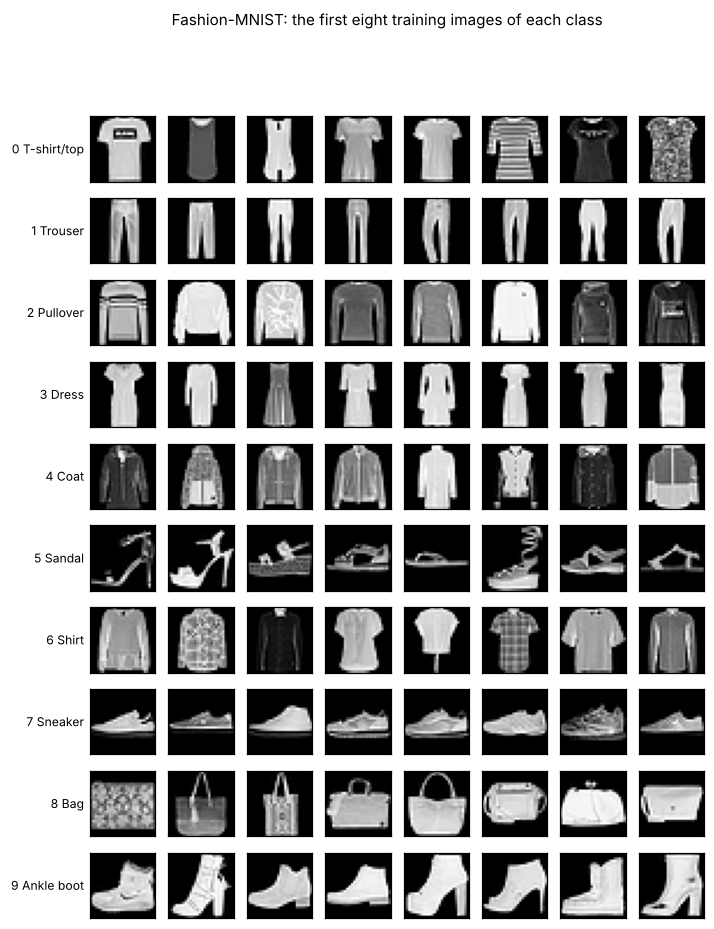
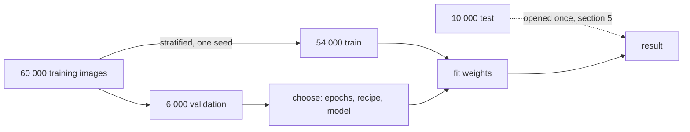
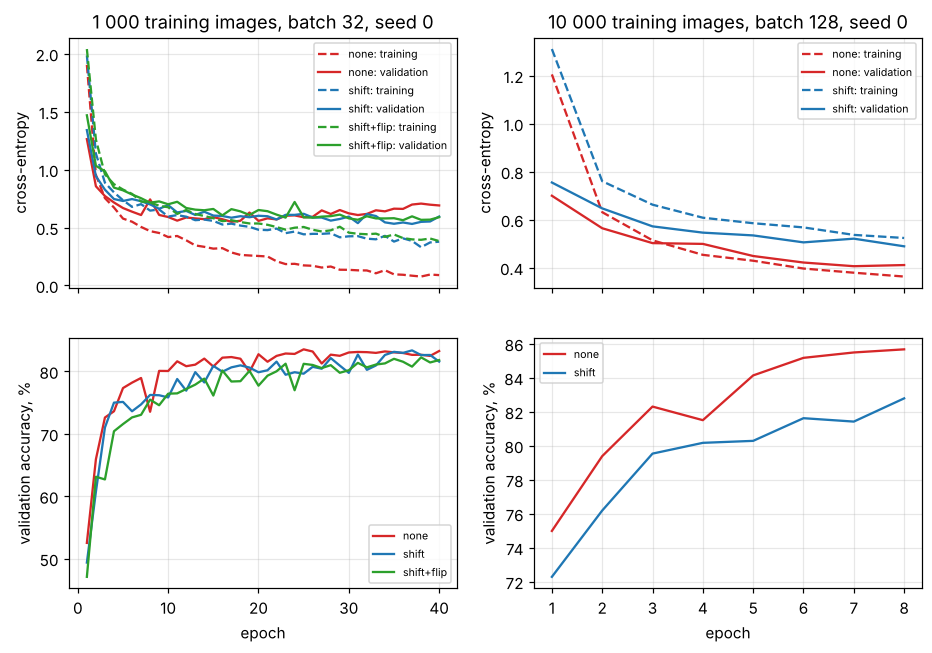
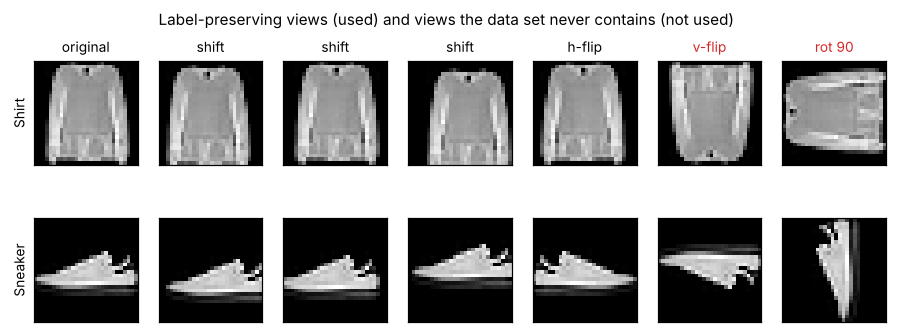
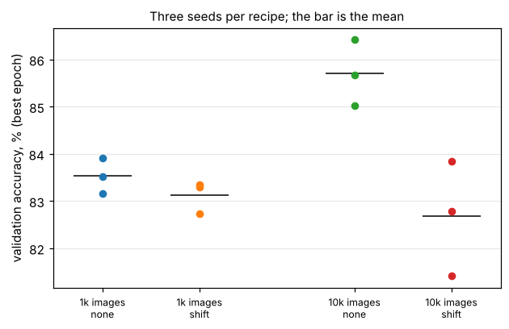

# Lesson 5 - Training a small classifier properly: splits, augmentation, metrics, confusion matrix

*Lesson 4 trained a network and quoted 98.9 %. It also chose how long to train on the same images it quoted, used one seed, and never asked which mistakes made up the missing 1.1 %. This lesson is the protocol that turns a number into a result.*

The network barely matters here; the habits do. A classifier is trained on one set of images, tuned on a second and reported on a third, and the third is opened once. Augmentation is a claim about the test images and gets checked against them. A run is repeated with other seeds before two recipes are called different. And the result is a confusion matrix, from which accuracy is one number among several.

The data is **Fashion-MNIST**: 70 000 real 28 × 28 grayscale photographs of clothing in ten classes, published by Zalando Research under the MIT licence, with 60 000 images for training and 10 000 the authors hold out as the test set. It is real, small, free to redistribute, reachable from the machine this course is written on (CIFAR-10 was not), and its classes confuse each other in a way a confusion matrix is built to show. `lesson5.py` downloads the four files once into `data/fashion-mnist/`, refuses any file whose SHA-256 differs from the one recorded in the script, prints every number below and writes every figure to `figures/lesson5/`.



## 0. Three sets, cut once

The 10 000 test images are set aside before anything else happens; the script loads them and does not look at them again until section 5. From the 60 000 training images a **validation** set is cut: 10 % of *each class*, chosen by one seed, so 54 000 remain for training and 6 000 hold exactly 600 per class. A plain random sample of 600 from this balanced set would hold between 46 and 77 per class; stratifying costs one loop and removes that noise from every comparison that follows.

```python
def stratified_split(y, fraction, seed):
    rng = np.random.default_rng(seed)
    val = []
    for c in np.unique(y):
        idx = np.nonzero(y == c)[0]
        rng.shuffle(idx)
        val.append(idx[: int(round(fraction * len(idx)))])
    val_idx = np.sort(np.concatenate(val))
    mask = np.ones(len(y), bool)
    mask[val_idx] = False
    return np.nonzero(mask)[0], val_idx
```

The three sets have three jobs. Training images fit the weights. Validation images make every decision: how many epochs, which augmentation, which architecture, which seed. Test images report the result of those decisions, once, and anything decided after looking at them is a decision made on the test set. Lesson 4 used its validation set for both of the last two jobs, which is why its 98.9 % is an optimistic number of unknown optimism.



## 1. A baseline, then the learning curve

Before a network, two numbers that any result must beat. The majority class scores 10.0 % on this balanced set. Multinomial logistic regression, `LinearNet`, is ten 28 × 28 templates and ten biases, 7 850 parameters; trained on a 1 000-image stratified subset it reaches 79.5 % validation accuracy. The network of the lesson, `SmallNet`, is lesson 4's shape with a ten-way linear head: two 3 × 3 convolutions (16 and 32 filters), two 2 × 2 pools, 20 490 parameters.

```python
for epoch in range(epochs):
    for idx in batches(order):
        xb = xt[idx] if augment is None else augment(xt[idx], g)
        loss = cross_entropy(net(xb), yt[idx])
        ...
    val_loss, val_acc = evaluate(net, val)  # scored after every epoch
    if val_acc > best_acc:  # the validation set picks the epoch
        best_state = copy(net.state_dict())
```

The training loop scores the validation set after every epoch and returns the weights of the best epoch. That is early stopping, and it is the first decision the validation set makes.



On 1 000 images with batches of 32, `SmallNet` without augmentation reaches 83.5 % at epoch 25 and stays there, while its training loss falls from 0.58 to 0.09 and its validation loss, lowest at 0.55 at epoch 17, climbs back to 0.69 by epoch 40. The accuracy is flat while the loss rises: the network is not making more mistakes, it is making the same mistakes with more confidence. Loss overfits before accuracy does, which is why both curves are worth drawing and why the stopping rule should say which one it watches. On 10 000 images with batches of 128 and 8 epochs the same network reaches 85.7 % with the validation loss still falling: ten times the data, and the run is not long enough to overfit.

## 2. Augmentation is a claim about the test set

An **augmentation** is a transformation applied to a training image on the fly that leaves its label true, so that the network sees a different image each epoch and cannot memorise the one it was given. The two used here are a random shift of up to 2 pixels in each direction, the uncovered border filled with the background black, and a left-right mirror with probability one half:

```python
def shift(xb, g, max_px=2):
    n, _, h, w = xb.shape
    padded = torch.nn.functional.pad(xb, (max_px,) * 4)
    dr = torch.randint(0, 2 * max_px + 1, (n,), generator=g)
    dc = torch.randint(0, 2 * max_px + 1, (n,), generator=g)
    return torch.stack([padded[i, :, r : r + h, c : c + w] for i, (r, c) in enumerate(zip(dr, dc))])
```

"Leaves its label true" is necessary and not sufficient. A mirrored sneaker is still a sneaker, but the test set will never contain one: the script measures that 99.7 % of sneakers and 100 % of ankle boots lie closer to their class mean than to its mirror image, so every shoe in Fashion-MNIST faces left. The images are centred by the dataset's authors: within a clothing class the horizontal centre of mass varies by 0.3 to 0.5 pixels (one standard deviation), within the bag and shoe classes by 0.6 to 1.4, so a 2-pixel shift is more movement than the test set contains. A vertical flip or a quarter turn produces images that are not in the test set at all. The question an augmentation must answer is not "is the label still right?" but "does the test set contain images like this?", and the figure's red columns are views that fail it.



The measurement, three seeds each (section 3 explains the format):

| images | epochs | none | shift | shift + flip |
|---|---|---|---|---|
| 1 000 | 40, batch 32 | 83.5 % (83.2 to 83.9) | 83.1 % (82.7 to 83.4) | 82.2 % (one seed) |
| 10 000 | 8, batch 128 | 85.7 % (85.0 to 86.4) | 82.7 % (81.4 to 83.9) | not run |

On 1 000 images the shift changes the peak accuracy by less than the spread between seeds. What it changes is the loss curve: with the shift the validation loss reaches its minimum at epoch 35 or later and ends at 0.55 to 0.59, where without it the loss ended at 0.69 to 0.71. The augmentation removed the overfitting and did not remove the errors, because the errors are not the kind a 2-pixel shift addresses (section 5 shows what kind they are). On 10 000 images at a fixed budget of 8 epochs the shift *costs* three points. Each augmented epoch is a harder problem, the network learns it more slowly, and a budget that was enough without augmentation is not enough with it: training loss 0.52 against 0.36 at the last epoch.

So augmentation is a regulariser: it trades training speed for a smaller gap between training and validation, and pays only when that gap is the problem. On a centred, size-normalised set it had nothing to pay for. On photographs of eggs from a camera that is never quite where it was, there is plenty to pay for, and lesson 4's patch generator did this job when it drew every egg at a random orientation under a random lamp. The habit is to measure it, as here, rather than to assume the textbook sign.

## 3. A number has a width

Every run above was repeated with three seeds, which change the initial weights, the order of the batches and the augmentation draws, and the tables give the mean with the lowest and highest value in brackets. At 1 000 images the three seeds of one recipe span 0.7 points; two recipes whose means differ by 0.4 points are the same recipe. At 10 000 images the spreads are 1.4 and 2.5 points, and the 3-point cost of the shift still stands clear: the worst seed without it beats the best seed with it.



A single-seed number, like lesson 4's 98.9 %, is one draw from a distribution of unknown width. And picking the best of three seeds on the validation set and reporting that seed's validation accuracy is selection on the reporting set, in the small: report the mean, or pick the seed on validation and report it on test.

## 4. The mistake that makes you look good

Augment first and split second, and the validation set contains shifted copies of training images. The script does this on purpose: the 1 000-image subset times four views (the original and three shifts) is 4 000 images, split 90/10 at random. 99.0 % of the validation images then have a sibling in the training half. A network trained for 15 epochs on that training half scores 88.0 % on that validation half and 83.4 % on the clean validation set. The leak flatters by 4.6 points, and nothing in the training log reveals it: the curves look like any other curves.

The same leak hides in two photographs of the same egg, two frames of one video, two days from one farm: anything that makes a validation image predictable from a training image. The rule is to split by *source* (egg, bird, farm, session, patient) before any transformation, and to decide what a source is before the first run, not after a suspiciously good one.

## 5. Worked example: the protocol end to end

**Task.** Train `SmallNet` on all 54 000 training images and report what it does on the 10 000 test images, with the mistakes named.

**Step 1, choose on validation.** Everything decided so far was decided on the validation set, at smaller scale: the architecture (section 1), no augmentation at a budget of about ten epochs (section 2), and the stopping rule (best validation epoch). Ten epochs on 54 000 images, batches of 128, take about 75 seconds on four CPU cores, and the validation accuracy per epoch is 84.5, 87.5, 88.5, 88.7, 88.3, 89.4, 89.9, 89.4, 90.3, 90.6 %: the network keeps improving to the end, so the kept weights are those of epoch 10, 90.6 %.

**Step 2, open the test set.** Test accuracy 90.1 %, macro F1 0.899. The validation number predicted the test number to within half a point, which is the sanity check the three-set protocol provides: had the test number come out several points lower, something in the choosing would have leaked.

**Step 3, read the confusion matrix.** Rows are the true class, columns the predicted one, so the row for Shirt says where shirts went and the column says what was called a shirt.


| class | precision | recall | F1 |
|---|---|---|---|
| T-shirt/top | 82.3 % | 88.2 % | 0.851 |
| Trouser | 98.5 % | 97.9 % | 0.982 |
| Pullover | 79.9 % | 88.5 % | 0.840 |
| Dress | 88.6 % | 91.0 % | 0.898 |
| Coat | 83.2 % | 86.1 % | 0.846 |
| Sandal | 97.5 % | 97.3 % | 0.974 |
| Shirt | 80.9 % | 62.2 % | 0.703 |
| Sneaker | 95.6 % | 95.1 % | 0.953 |
| Bag | 98.6 % | 97.2 % | 0.979 |
| Ankle boot | 95.6 % | 97.1 % | 0.963 |

**Precision** of a class is read down its column: of everything called a shirt, how much was a shirt. **Recall** is read along its row: of the shirts, how many were called shirts. **F1** is their harmonic mean, and **macro F1** is the mean of the ten F1 values, which weights every class equally where accuracy weights every image equally; on a balanced test set the two agree, on an imbalanced one they do not, and the number to quote is the one that matches what a mistake costs.

The matrix says what the single accuracy could not. Of the 994 test errors, 634 are among four classes: T-shirt/top, Pullover, Coat and Shirt, which are all upper-body garments seen from the front at 28 pixels. Shirt is the worst, with recall 62.2 %: 154 shirts were called T-shirts, 104 pullovers and 78 coats, and the examples in the figure show why; a short-sleeved shirt and a T-shirt differ by a collar and a placket a pixel or two wide. The shoes confuse almost only each other, and Trouser, Sandal, Sneaker, Bag and Ankle boot are above 95 % on both measures. A network that is "90.1 % accurate" is a network that is excellent on five classes, good on Dress and guessing between four, and the next step is not another epoch but more shirts, larger images, or the decision that shirt versus T-shirt is not a distinction the application needs.

**What is fragile here.** The test set is the authors' and was opened once, but the same test set has been public since 2017 and every published recipe for it was chosen by people who could see it; a benchmark's test set leaks slowly through the literature. The full run was done with one seed, so the test accuracy has an unmeasured width, probably a few tenths of a point by the subset spreads and the binomial standard error (exercise 1). Everything was chosen with one validation split. And a 20 490-parameter network trained for ten epochs is far from what this dataset supports: the point was the protocol, and the protocol is what transfers.

## Exercises

1. The test set has 10 000 images and the accuracy is 90.1 %. Treating each image as a coin with that probability of success, what is the standard error of the accuracy? Which differences in section 2's table are larger than twice the corresponding standard error for a 6 000-image validation set, and which are not?
2. From the confusion figure, compute Shirt's precision and recall by hand from its column and row, and check them against the table. Then say what happens to Shirt's precision if the network is retrained to call every doubtful upper-body garment a shirt, and what happens to its recall.
3. Which of these leak, and why: (a) standardising images with the mean and standard deviation of all 70 000 images; (b) choosing the number of epochs on the test set; (c) choosing the best of three seeds on the validation set and reporting its validation accuracy; (d) a belt camera whose frames at t and t + 1 s land in train and test; (e) exact duplicate images in the training and test set.
4. Name two augmentations that are both label-preserving and inside the test distribution for Fashion-MNIST, and one that is label-preserving and outside it besides the mirror. Then name the three things lesson 4's `render_patch()` randomises that are augmentations in all but name.
5. Lesson 4 reported 98.9 % validation accuracy for `EggNet`. List what this lesson's protocol would change in how that number was produced, and what the sentence reporting it would look like afterwards (its form, not its value).

<details>
<summary>Answers</summary>

**1.** The standard error is √(p(1 − p)/n): for p = 0.901 and n = 10 000 it is about 0.3 points, so the test accuracy is 90.1 % ± 0.6 at two standard errors. On 6 000 validation images at p ≈ 0.84 the standard error is 0.47 points and twice it is about 0.9: the 3.0-point cost of the shift at 10 000 images is well outside it, the 0.4-point gap between none and shift at 1 000 images is inside it, and the seed spreads (0.7 to 2.5 points) are of the same size as the measurement noise, which is why they are reported with the number rather than instead of it.

**2.** Precision is the diagonal entry over the column sum, recall the diagonal entry over the row sum; the column for Shirt includes every T-shirt, pullover, dress and coat that was called a shirt, the row includes every shirt called something else. Calling every doubtful garment a shirt moves images from other rows into the Shirt column: recall rises (fewer shirts escape) and precision falls (more non-shirts are caught).

**3.** (a) A mild leak: two numbers summarising 70 000 images carry almost no information about any one of them; compute them on the training set anyway, the habit costs nothing. (b) A leak: the epoch count is a tuned parameter and the test set tuned it. (c) A leak in the small: the reported number was selected as the maximum of three, so it is biased upward; report the mean, or report the chosen seed on the test set. (d) A leak: consecutive frames are near-duplicates, exactly section 4's shifted copies; split by sequence. (e) A leak, and a known one in several public sets; deduplicate before splitting, or at least report how many test images have a training twin.

**4.** Inside the distribution: a small change of brightness or contrast (the garments are photographed under varied lighting), and a shift of one pixel, since the centring leaves sub-pixel variation; a slight scale change is arguable. Outside it: a rotation of more than a few degrees, since every item is upright. Lesson 4's generator randomises the egg's orientation (0 to 180°), its size, the lamp level (0.3 to 1.0) with its gradient, and the noise; each is an augmentation, applied before the data existed rather than during training.

**5.** Cut a test set from a *third* seed and never score it until the end; choose the epoch count on validation and keep those weights rather than the last epoch's; train three seeds and quote mean and range; report a confusion matrix over the six kinds of patch, which the per-kind table in lesson 4 nearly is; and say which choices were made on which set. The sentence becomes "mean 98.x % (range a to b over three seeds) on a 1 000-patch test set from a third seed, with the epoch count chosen on a separate validation set; errors are concentrated on labels (c of 100)".

</details>

## What to read next

- **Lesson 6** of this course: a pre-trained detector fine-tuned on a few dozen images, where the split is by image, the metric is mean average precision and the test set is smaller than one would like.
- Goodfellow, Bengio and Courville, *Deep Learning*, chapter 7 (free online): 7.4 for augmentation as a regulariser, 7.8 for early stopping; chapter 11 for the practical methodology.
- Kaufman, Rosset, Perlich and Stitelman, "Leakage in Data Mining: Formulation, Detection, and Avoidance", 2012: section 4's examples are section 4 of this lesson at industrial scale.
- Xiao, Rasul and Vollgraf, "Fashion-MNIST: a Novel Image Dataset for Benchmarking Machine Learning Algorithms", 2017 (arXiv:1708.07747): how the set was made, including the centring, and the benchmark table this lesson's network is nowhere near.
- Powers, "Evaluation: From Precision, Recall and F-Measure to ROC, Informedness, Markedness and Correlation", 2011: what the confusion matrix contains beyond the three numbers used here.
- Recht, Roelofs, Schmidt and Shankar, "Do ImageNet Classifiers Generalize to ImageNet?", 2019: what happened when a public test set was replaced by a fresh one, and why "What is fragile here" mentions 2017.
