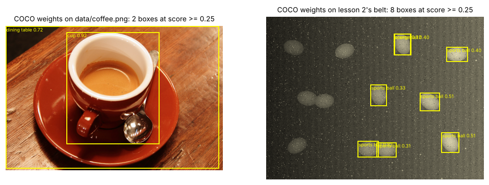
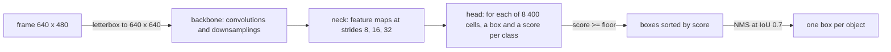
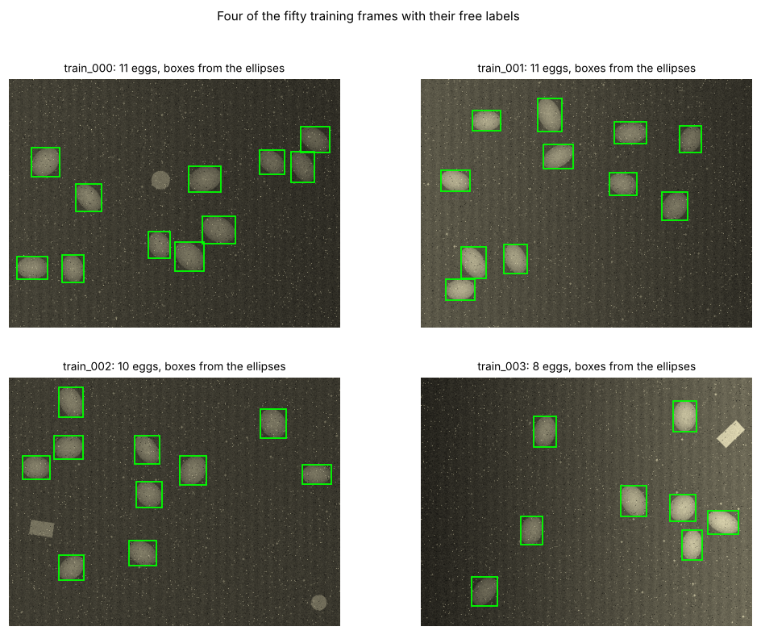
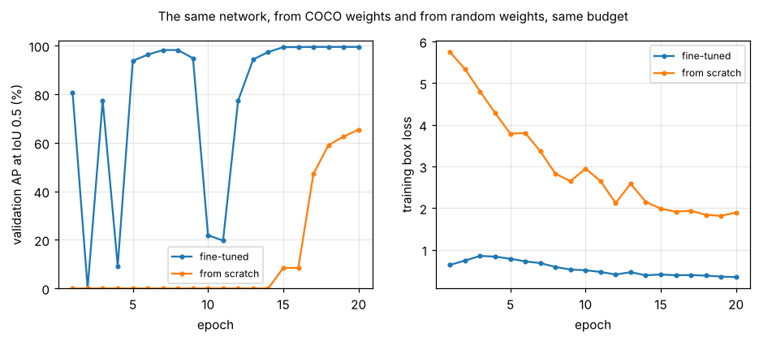
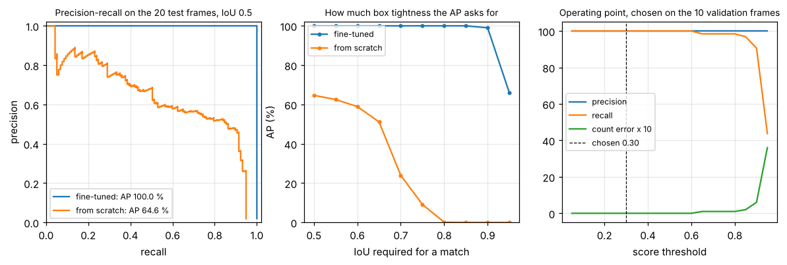
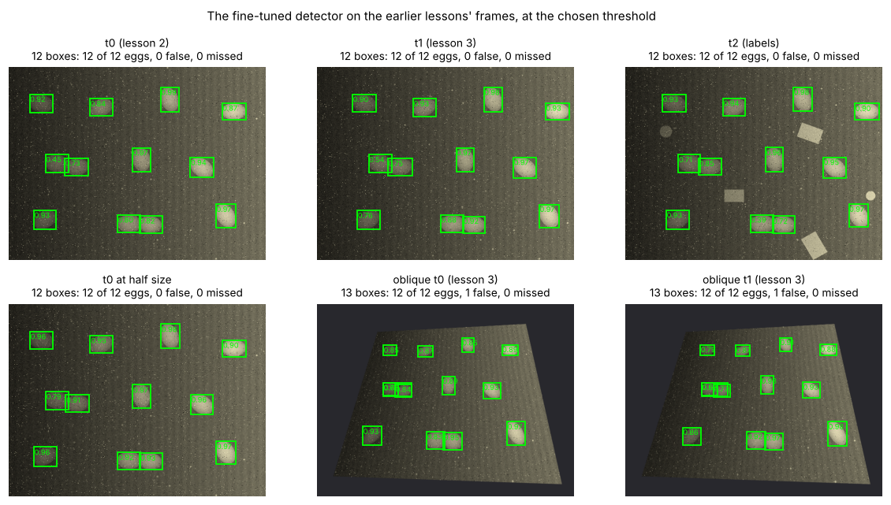

# Lesson 6 - Object detection with a pre-trained model: fifty images, mAP, the edge

*Lesson 2 counted eggs with a threshold and a distance transform, lesson 4 with a 6 129-parameter network slid over the frame. This lesson takes a detector that someone else trained on a hundred thousand photographs, teaches it the one thing it does not know, and scores it the way detectors are scored.*

A detector returns a list: for each thing it found, a box, a class and a score. Three consequences follow. It must be trained on images with boxes drawn on them, the expensive part of any detection project. Its output must be reduced to one box per object, above a threshold someone chooses. And the result is a curve, not a number, because every threshold gives a different list; **average precision** is the area under that curve, and is what "mAP" summarises.

`lesson6.py` downloads the COCO weights of YOLOv8n once (6.5 MB, from the Ultralytics GitHub release, refused unless the SHA-256 matches the one in the script), fine-tunes them on fifty synthetic belt frames, trains the same network from random weights for comparison, scores both with an average precision written out in NumPy and checked against the library's, runs the result on the frames of lessons 2 to 4, and exports it to ONNX for a latency table. Every number below is printed by the script.

## 0. What a pre-trained detector already knows

**YOLOv8n** is the smallest of the YOLOv8 family: 3 157 200 parameters, 8.9 GFLOPs at a 640-pixel input, and weights trained by Ultralytics on COCO, about 118 000 photographs with boxes for 80 everyday classes. On `data/coffee.png` it returns two boxes at the library's default threshold of 0.25, *cup* at 0.92 and *dining table* at 0.72.



On lesson 2's belt it returns eight boxes above 0.25, seven *sports ball* (0.31 to 0.51) and one *orange*, all on the brighter right-hand half; at 0.05 it adds three *frisbees* and one more ball, twelve boxes for twelve eggs. The detector sees the eggs. It has no name for them, and it has never seen a lamp that fades to 30 % on the left, so its scores there fall under the threshold; fine-tuning fixes both.



The architecture is lesson 4's idea at scale: the backbone turns a 640 × 640 input into feature maps of 80 × 80, 40 × 40 and 20 × 20 cells, 8 400 in all, and the head predicts a box and a score per class for every cell, as `EggNet` gave one logit per 4 × 4 cell. What lesson 4 did with a threshold and a local maximum, the detector does with a score floor and **non-maximum suppression** (NMS): sort the boxes by score, keep the strongest, drop every box overlapping it by more than 0.7 **intersection over union** (IoU, overlap area over union area), repeat.

## 1. Fifty frames with boxes

Boxes are the cost of detection. A classifier needs one word per image; a detector needs every object outlined, and a missed outline teaches the network that the object is background. On real photographs that is hours in a tool such as CVAT, and the clicks set the ceiling (exercise 3). Here the labels are free, because the frames are rendered: `make_scene(seed)` draws lesson 2's belt with 2 to 12 eggs at random places, sizes and angles, at least 48 px apart so pairs may touch, up to three of lesson 4's labels and two blobs kept clear of the eggs, dirt, a lamp of random strength on either side, read noise and dead pixels. The box around an egg follows from its ellipse:

```python
def ellipse_box(r, c, a, b, deg):
    t = np.deg2rad(deg)
    hw = np.sqrt((a * np.cos(t)) ** 2 + (b * np.sin(t)) ** 2)
    hh = np.sqrt((a * np.sin(t)) ** 2 + (b * np.cos(t)) ** 2)
    return np.array([c - hw, r - hh, c + hw, r + hh])
```



The split is by frame, from disjoint seeds: 50 training frames (360 eggs), 10 validation (64) and 20 test (117), with boxes 38 to 68 px on a side in 640 × 480 frames. Lesson 5's rule applies: training frames fit the weights, validation frames choose the epoch and the operating point, test frames are scored once. Each frame goes to disk as a PNG and a text file in the YOLO label format, one line per box with the class, centre, width and height as fractions of the image.

## 2. Fine-tuning, against starting from nothing

Fine-tuning keeps the COCO weights except in the last layer of the class head, rebuilt for one class, and trains the whole network on the new frames. The recipe is the library's default: 20 epochs, batches of 8, a mosaic augmentation that stitches four frames into one for the first ten epochs, random scaling by up to 50 %, horizontal flips and a 10 % translation. After each epoch the validation frames are scored and the checkpoint with the best validation AP at IoU 0.5 to 0.95 is kept: the validation set picks the epoch, as in lesson 5. The control is the same architecture from random weights, same data, same recipe; it settles which part of the result is the pre-training.



| run | validation AP50 by epoch (%) | best | CPU time |
|---|---|---|---|
| from COCO weights | 81 0 77 9 94 96 98 98 95 22 20 77 94 97 99 99 100 100 100 100 | 99.5 % at epoch 17 | 184 s |
| from random weights | 0 0 0 0 0 0 0 0 0 0 0 0 0 0 8 8 47 59 63 65 | 65.5 % at epoch 20 | 176 s |

From COCO weights the detector finds four eggs in five after one epoch and nearly all after five. From random weights it finds nothing for fourteen epochs and is still climbing at twenty, its box loss four to five times higher throughout. Fifty frames teach a network *which* of the things it already sees are eggs; they are nowhere near enough to teach it to see.

The fine-tuned run's validation AP also falls to near zero at epochs 2, 4, 10 and 11 while its training loss falls smoothly; without the validation set nothing would reveal that the weights of epoch 10 are unusable and those of epoch 9 nearly perfect. The script does not chase the cause (exercise 4 says how); it keeps the epoch the validation set chose, 17, first of four that tie.

## 3. Average precision, written out

At a score floor of 0.001 the detector returns 300 boxes per frame, nearly all junk. That is intended: average precision asks not whether the boxes are right at one threshold but how well the *scores rank* the right ones above the wrong ones. The computation:

1. Pool every detection from every test frame and sort by score, strongest first.
2. Walk the list. A detection is a **true positive** if the best-overlapping unclaimed true box in its frame overlaps it by at least the IoU threshold, 0.5 for "AP50", and that true box is then claimed; otherwise it is a **false positive**, a box on nothing or a second box on an egg already found.
3. After each detection, precision is true positives over detections so far and recall is true positives over the 117 eggs: a precision-recall curve with one point per detection.
4. AP is the mean, over 101 recall levels from 0 to 1, of the best precision reached at that recall or any higher one; the "or higher" removes the saw-tooth that a false positive makes.

```python
def average_precision(precision, recall, points=101):
    ap = 0.0
    for r in np.linspace(0, 1, points):
        above = precision[recall >= r]
        ap += above.max() if len(above) else 0.0
    return ap / points
```



On the 20 test frames, scored once, the fine-tuned detector's AP50 by this computation is 100.0 %: all 117 eggs rank above the first false positive. The library's `val` reports 99.5 % on the same detections, and the half point is its definition, not a disagreement: it integrates the curve by the trapezoid rule after appending a point of precision 0 at the final recall, so a perfect ranking scores a shade under 100. The from-scratch detector scores 64.6 % by hand and 64.8 % by the library; its curve is what a weak ranking looks like.

**mAP** is a mean over classes, so with one class it is the AP; **mAP50-95** is also a mean over IoU thresholds from 0.5 to 0.95 in steps of 0.05, COCO's headline number, which asks for tight boxes as well as found objects. The fine-tuned detector holds 100 % up to an IoU of 0.85, 99 % at 0.9 and drops to 66 % at 0.95, where a box half a pixel loose on each side of a 40-pixel egg already fails (exercise 2); the from-scratch detector's boxes are placed but loose, and it falls from 65 % at 0.5 to nothing at 0.8. Their mAP50-95 are 96.5 % and 27.0 % by hand, 95.9 % and 27.7 % by the library. When a paper quotes "mAP", ask which it means.

## 4. The operating point

AP scores a ranking; a counter needs a decision, a score at or above which a box is an egg. That is a choice, and lesson 5 said where choices are made: the script sweeps thresholds from 0.05 to 0.95 on the ten validation frames and records precision, recall and the mean absolute count error per frame.

| threshold | precision | recall | mean count error |
|---|---|---|---|
| 0.05 | 100.0 % | 100.0 % | 0.00 |
| 0.25 | 100.0 % | 100.0 % | 0.00 |
| 0.50 | 100.0 % | 100.0 % | 0.00 |
| 0.75 | 100.0 % | 98.4 % | 0.10 |
| 0.95 | 100.0 % | 43.8 % | 3.60 |

Every threshold from 0.05 to 0.60 counts the validation frames perfectly, which does not say which to use. The script's rule: keep the thresholds with the lowest count error, among them the highest precision, then the highest recall, and take the *middle* of what remains. An operating point at the edge of a plateau is one shift of the scores from failing; one in the middle survives a different lamp or a new batch of eggs. The chosen threshold is 0.30; on the test frames at 0.30 precision and recall are both 100 % and no frame is miscounted.

## 5. Worked example: the counter of lessons 2 and 4, replaced, and taken to the edge

**Task.** Run the fine-tuned detector at 0.30 on the frames the earlier lessons scored, with lesson 4's scorer (a box centre within 15 px of a true centre claims that egg), then find out what it would cost to run on a device. For comparison, lesson 2's counter needed rectification to find 12 on the oblique views, and lesson 4's `EggNet` found 10 of 12 at half size.



| frame | boxes | eggs found | false alarms |
|---|---|---|---|
| t0 (lesson 2's belt) | 12 | 12 of 12 | 0 |
| t1 (shifted 37 px, fresh noise) | 12 | 12 of 12 | 0 |
| t2 (labels and blobs) | 12 | 12 of 12 | 0 |
| t0 at half size (320 × 240) | 12 | 12 of 12 | 0 |
| oblique t0 (lesson 3) | 13 | 12 of 12 | 1 |
| oblique t1 (lesson 3) | 13 | 12 of 12 | 1 |

Every egg on every frame, with no rectification, pyramid or hand-tuned radius. The half-size frame is found because the recipe's scale augmentation showed the network small eggs in training, lesson 5's claim about the test set made true. The oblique views were never shown to it, and it finds all twelve eggs on both. The one false alarm on each is a 70 × 33 px box at score 0.66 spanning a touching pair, which the oblique camera foreshortens into one wide blob; it overlaps each of the pair's own boxes by an IoU near 0.5, under the 0.7 at which NMS merges, and a stricter NMS would start merging real pairs too.

**The edge.** The script exports the fine-tuned network to ONNX at three input sizes and runs each with ONNX Runtime through a pipeline written out in the script: `letterbox()` resizes and pads the frame to a grey square, the session returns an array of shape (1, 5, anchors), `decode()` turns each anchor's centre, width, height and score into a box in frame pixels, and `nms()` keeps one box per egg. The AP in the table comes from that pipeline, which is the check that it is right.

| input | ONNX file | AP50 on the test frames | ms per frame, 1 thread | ms per frame, 4 threads |
|---|---|---|---|---|
| 640 × 640 | 12.7 MB | 100.0 % | 77 | 31 |
| 320 × 320 | 12.6 MB | 99.6 % | 19 | 9 |
| 160 × 160 | 12.6 MB | 58.5 % | 5 | 3 |

The times are this sandbox's 2.1 GHz Xeon, median of ten runs, comparable only with each other; three things transfer. The file does not shrink with the input, because it holds the weights, 3 million at four bytes each; the compute does, by the square of the input side, so 320 pixels is four times cheaper and costs 0.4 points here, the eggs being still 20 pixels across. At 160 the eggs are 10 pixels, the coarsest feature cell covers a whole one, and the AP collapses to 58.5 %; nothing at 640 would have warned of that. And the single-thread column is the realistic one: a Raspberry Pi-class board shares four slow cores with everything else.

Where it cannot go is instructive. An ESP32, the controller in the course author's incubator and poultry-house firmware, has about 520 KB of RAM; this network's weights are 12 MB in float32 and 3 MB after 8-bit quantisation, before any activation memory. The detector lives on a board or a phone and the microcontroller receives counts, which is what the smart-poultry-farm repository documents: its app shows bird counts from an external vision tool, and the ESP32 never sees a pixel. Two costs are not in the table. The weights and training code are Ultralytics', under the AGPL-3.0, which a product shipping them must comply with or license; torchvision's BSD-licensed detectors are the usual alternative. And the 100 % is on frames from the generator that made the training frames: the protocol works, eggs are not solved.

**What is fragile here.** The test set is synthetic and easy, and "100 %" on 117 eggs means "no error in 117", not zero. The dips in the fine-tuning curve are reported, not explained. The latency table is one machine. One seed trained each detector. And the operating point was chosen on ten frames with a plateau so wide that the rule, not the data, chose it.

## Exercises

1. A test set has 10 eggs and a detector returns, in score order, TP, TP, FP, TP, FP, FP, TP and nothing else. Write the precision-recall points, apply the envelope and compute the 101-point AP50. What does the AP become if the three false positives move to the end of the list, and what does that say AP measures?
2. For a 40 × 44 px egg, by how many pixels may a box be loose on every side and still reach an IoU of 0.95? Of 0.5? Which does counting need, and which would a robot picking the egg up need?
3. A labeller draws boxes a few pixels loose and occasionally forgets an egg. Which section-3 number does each mistake damage, and at which IoU thresholds? What does a forgotten egg in a *training* frame teach the network, and why is that worse than one forgotten in a test frame?
4. The fine-tuned run's validation AP collapses at epochs 2, 4, 10 and 11 while the training loss falls. Give three one-change checks that would tell whether the cause is the optimiser's warm-up, the moving average of the weights the library validates with, or batch-norm statistics gathered on mosaic batches.
5. On a real belt the lamp dims over months and every egg's score drifts down. Describe a two-number monitor, computed from the detector's own output on unlabelled frames, that warns before the count error appears, and say what a human must still do that it cannot.

<details>
<summary>Answers</summary>

**1.** Recall after each detection: 0.1, 0.2, 0.2, 0.3, 0.3, 0.3, 0.4; precision: 1, 1, 2/3, 3/4, 3/5, 1/2, 4/7. The envelope is 1 at recall levels up to 0.2, max(3/4, 4/7) = 3/4 up to 0.3, 4/7 up to 0.4 and 0 above. Over 101 levels: 21 at 1, 10 at 3/4, 10 at 4/7, 60 at 0, so AP ≈ (21 + 7.5 + 5.71)/101 = 33.9 %. With the false positives last, precision is 1 up to recall 0.4 and AP = 41/101 = 40.6 % with the same four eggs found: AP rewards the *ordering* of the scores, and a false positive costs less the lower it ranks.

**2.** A box d pixels loose on every side of a w × h box has IoU wh / ((w + 2d)(h + 2d)). For 40 × 44 and 0.95, (40 + 2d)(44 + 2d) ≤ 1 853 gives d ≤ 0.5 px; for 0.5, (40 + 2d)(44 + 2d) ≤ 3 520 gives d ≤ 8.7 px. Counting needs 0.5 or less, since any box on the egg counts it; a gripper needs the centre within millimetres and so the tight threshold, and the middle panel of the AP figure is what tells the two apart.

**3.** Loose boxes damage AP at high IoU thresholds and leave AP50 nearly untouched; a forgotten egg in a test frame turns a correct detection into a false positive at every threshold. A forgotten egg in a training frame is labelled background, so the network is trained to suppress the exact pattern it should fire on: a test omission mis-scores, a training omission mis-trains.

**4.** Warm-up: set `warmup_epochs=0` (or lengthen it) and see whether the early dips move. Moving average: validate `last.pt` as well as the averaged weights after each epoch and see whether the raw weights dip too. Batch norm: train with `mosaic=0` from the start and see whether the dips at 10 and 11, the epochs around the mosaic switch-off, disappear. A dip that survives all three has another cause.

**5.** The mean score of the boxes above the threshold, and the number of boxes in the band just below it (0.2 to 0.3 for a threshold of 0.3). Both drift before the count does: scores slide down together, and boxes pile up under the threshold before dropping out. A human must still label a few new frames now and then; without ground truth neither number tells a failing detector from an emptier belt.

</details>

## What to read next

- Lin et al., "Microsoft COCO: Common Objects in Context", 2014 (arXiv:1405.0312), and the evaluation page at cocodataset.org: where the 101-point AP and the 0.5:0.95 thresholds come from.
- Redmon, Divvala, Girshick and Farhadi, "You Only Look Once: Unified, Real-Time Object Detection", 2016 (arXiv:1506.02640): the original one-pass detector, whose grid of cells each predicting a box is still section 0's diagram.
- Ren, He, Girshick and Sun, "Faster R-CNN: Towards Real-Time Object Detection with Region Proposal Networks", 2015 (arXiv:1506.01497): the two-stage alternative, the ancestor of torchvision's detectors.
- The Ultralytics documentation for `train`, `val` and `export` (docs.ultralytics.com): every default this lesson left alone, with its meaning, and the licence page on what the AGPL-3.0 asks of a product.
- Padilla, Netto and da Silva, "A Survey on Performance Metrics for Object-Detection Algorithms", 2020: the half-dozen definitions of AP in use and how far they disagree; section 3's half point is the smallest case.
- The ONNX Runtime documentation on quantisation: the step after this lesson's table, for a board that needs the 3 MB model.
